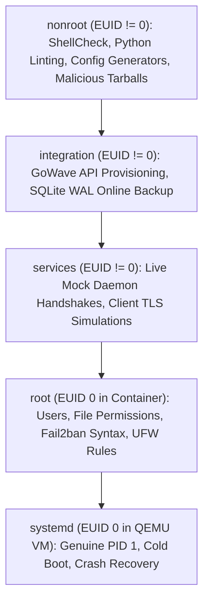

# Testing Strategy & CI Architecture: GoWave Auto NGINX

**Document Status**: Authoritative Specification  
**Source Baseline**: `community-baseline/tests/run_ci.py` (`community-baseline`) and `gowave-node/tests/`  
**Purpose**: Define the 5-suite testing architecture, runner contract, EUID privilege separation, test matrix, and acceptance gates for GoWave Auto NGINX.

---

## 1. Test Runner Contract & Privilege Separation

GoWave Auto NGINX adopts the exact test runner architecture of `community-baseline/tests/run_ci.py`. The runner verifies test completeness dynamically and enforces strict process EUID privileges before running any suite:

```bash
# Verify test inventory and completeness (zero unassigned or stale TestCase classes)
python3 tests/run_ci.py --check-completeness

# Run specific suite
python3 tests/run_ci.py --suite <name>

# Official OpenSpec strict validation (version 1.16.1)
openspec validate --all --strict
# or target specific change:
openspec validate gowave-auto-nginx --strict
```

### Privilege Context Enforcement

| Suite Name | Permitted EUID | Required Execution Environment | Forbidden Operations |
|---|---|---|---|
| **`nonroot`** | `os.geteuid() != 0` (Unprivileged) | Bare host or unprivileged container (`--user 1001:1001`) | Any `sudo`, filesystem mutation outside `/tmp`, network binds < 1024 |
| **`integration`**| `os.geteuid() != 0` (Unprivileged) | Bare host or unprivileged container (`--user 1001:1001`) | Systemd modifications, real firewall/iptables changes |
| **`services`** | `os.geteuid() != 0` (Unprivileged) | Mock container / local unprivileged environment (`--user 1001:1001`) | Host network manager changes, host DNS changes |
| **`root`** | `os.geteuid() == 0` (Root) | **Disposable throwaway container ONLY** | Bare host execution; changes to developer's host OS |
| **`systemd`** | `os.geteuid() == 0` (Root inside VM) | **QEMU TCG Virtual Machine with genuine PID 1 systemd** | Direct container execution lacking genuine systemd |

If `run_ci.py` is invoked with an incorrect EUID, it immediately terminates with code 1 and outputs:
```text
PRIVILEGE: FAIL — <suite> requires EUID 0 (or EUID != 0)
```

---

## 2. Test Suites & Verification Contracts



### Suite 1: `nonroot` (L1 Static Linting & Unit Logic)
- **Privilege**: Strictly non-root (`id -u != 0`).
- **Tests Covered**:
  - `test_shellcheck`: ShellCheck on all bash scripts (`SC1090`, `SC1091` ignored where appropriate).
  - `test_python_lint`: `flake8` and `mypy` on management Python utilities.
  - `test_scripts_py`: Execution of `python3 tests/test_scripts.py` verifying CLI script arguments and basic handlers.
  - `test_openspec`: OpenSpec CLI validation (`openspec validate --all --strict` / `openspec validate gowave-auto-nginx --strict`).
  - `test_nginx_generator`: NGINX Stream and HTTP configuration generator tests for Debian 12 (NGINX 1.22 `listen ... http2;`) and Ubuntu 24/Debian 13 (`http2 on;`).
  - `test_archive_security`: Malicious tarball injection tests verifying rejection of `../` path traversals, leading `/`, symlinks escaping managed roots, device nodes, and FIFOs.
  - `test_node_secret_parser`: Unit tests verifying base64 `SECRET_KEY` parsing and HKDF-SHA256 SNI derivation (`rw-v1`).

### Suite 2: `integration` (L3 Inter-Process Contracts & Online Backup)
- **Privilege**: Non-root (`id -u != 0`).
- **Tests Covered**:
  - `test_sqlite_online_backup`: Continuous write transactions executed concurrently while `sqlite3 <db> ".backup <dest>"` executes; verify destination database passes `PRAGMA integrity_check;` with 100% data consistency.
  - `test_gowave_api_auth`: GoWave API admin bootstrap: query `/api/auth/status`, register initial admin via `POST /api/auth/register`, login via `POST /api/auth/login`, and verify JWT token issuance.
  - `test_profile_provisioning`: Authenticated creation of Config Profile via `POST /api/config-profiles`, inbound generation, and verification of `GET /api/config-profiles/{uuid}/computed-config`.
  - `test_node_association`: Verification of linking profile and inbounds to node via `POST /api/nodes` or `PATCH /api/nodes/{uuid}` with `{"configProfile": {"activeConfigProfileUuid": "<uuid>", "activeInbounds": [...]}}`.
  - `test_host_provisioning`: Automated creation of Host records via `POST /api/hosts` for each MVP protocol and verification via `GET /api/hosts`.
  - `test_response_rules_and_templates`: Verification that `DisableSubscriptionAccessByPath=false` in GoWave database and default templates (`MIHOMO` and `XRAY_JSON`) are seeded and intact.
  - `test_mtls_handshake`: Go test vectors validating Node mTLS 1.3 handshake with derived HKDF SNI and RS256 JWT bearer token against mock TLS server.

### Suite 3: `services` (L4 Live Services & Protocol Simulation)
- **Privilege**: Non-root (`id -u != 0`).
- **Tests Covered**:
  - `test_stream_sni_routing`: NGINX Stream routing port 443 into `panel_domain` (7443) and `reality_domain` (8443).
  - `test_reality_fallback`: Legitimate REALITY client handshake vs scanner probe; verify fallback sends PROXY protocol v1 to port 9443 where decoy static site is served.
  - `test_xhttp_streaming`: Bidirectional HTTP/1.1 and HTTP/2 POST stream sent to `https://panel_domain/<xhttp_path>/`; verify NGINX reverse proxies to loopback port without chunk buffering or request body truncation.
  - `test_websocket_upgrade`: Verification of WebSocket handshake and protocol upgrade headers.
  - `test_xray_subscription`: Fetch `GET /api/sub/{shortUuid}/v2ray-json`; verify HTTP 200, `Content-Type: application/json`, non-empty body, parseable Xray JSON format containing all 4 MVP protocols, and zero internal leaks (`127.0.0.1`, internal ports, unix sockets).
  - `test_mihomo_subscription`: Fetch `GET /api/sub/{shortUuid}/mihomo`; verify HTTP 200, `Content-Type: text/yaml`, non-empty body, parseable Mihomo YAML format containing client-compatible MVP protocols, and zero internal leaks.
  - `test_client_import_validators`: Pass fetched Xray JSON and Mihomo YAML subscriptions to official client schema parsers/validators to ensure 100% client importability.
  - `test_node_firewall_isolation`: Verify that external connections to `<public-ip>:3002` are dropped or refused by firewall rules, while local loopback connections succeed.

### Suite 4: `root` (L2 Filesystem Permissions & Isolated System Drop-Ins)
- **Privilege**: Root (`id -u == 0`) inside disposable Docker container.
- **Tests Covered**:
  - `test_user_permissions`: Creation of user `gowave:gowave`, verify directory permissions `1770 root:gowave` on `/opt/gowave`, and verify executable is owned by `root:root`.
  - `test_service_install`: Execution of `gowave-server service install /opt/gowave` and verification of generated `90-unprivileged.conf` and `gowave-update.path`.
  - `test_secret_delivery`: Delivery of `SECRET_KEY` via stdin or temporary `0600` file; verify process inspection via `/proc/<pid>/cmdline` reveals zero credentials.
  - `test_fail2ban_syntax`: Validation of `/etc/fail2ban/jail.d/90-gowave-auto-nginx.local` via `fail2ban-client --test`.
  - `test_backup_format_v1`: Generation of `GoWave Auto NGINX Backup Format v1` archive; verify mode `0600` and validation of `meta.json` manifest.

### Suite 5: `systemd` (L5 Genuine PID 1 Systemd in QEMU TCG Guest)
- **Privilege**: Root (`id -u == 0`) inside QEMU virtual machine.
- **Target OS Matrix**: Ubuntu 24.04 LTS, Ubuntu 26.04 LTS, Debian 12, Debian 13.
- **Tests Covered**:
  - `test_qemu_clean_install`: Clean installation in fresh OS image; verify all services (`gowave`, `gowave-node`, `nginx`, `fail2ban`) start and reach `active (running)`.
  - `test_qemu_port_conflict`: Preflight port conflict test: simulate busy port 3000, 3001, or 3002; verify installer detects conflicting process and aborts without altering system state.
  - `test_qemu_cold_reboot`: Execute `systemctl reboot`; verify all services, firewall rules, and DoT configurations persist and resume automatically.
  - `test_qemu_channel_switching`: Switch from Stable to Dev via `gowave-auto.sh channel dev`, verify health, then switch back from Dev to Stable via `gowave-auto.sh channel stable --force`, verifying pre-switch snapshot creation and health.
  - `test_qemu_update_rollback`: Trigger `gowave-auto.sh update` with simulated post-update migration crash; verify automatic rollback from `/var/lib/gowave-auto-nginx/recovery/` restores original operational state.
  - `test_qemu_power_loss_recovery`: Simulate hard power cut / SIGKILL during update transaction; verify journal state machine initiates recovery on subsequent boot.

---

## 3. GitHub Actions CI Pipeline Architecture

| Workflow File | Trigger Events | Required Suites & Tasks | Status Check Name | Permissions |
|---|---|---|---|---|
| `lint-and-nonroot.yml` | Push, Pull Request | Suite `nonroot`, ShellCheck, actionlint, completeness check | `lint-and-nonroot` | `contents: read` |
| `root-integration.yml` | Push, Pull Request | Suite `root` (EUID 0) & Suite `integration` (container `--user 1001:1001`, EUID != 0) | `root-integration` | `contents: read` |
| `systemd-acceptance.yml` | Schedule (daily), Manual dispatch | Suite `services` & Suite `systemd` across Ubuntu 24/26 & Debian 12/13 | `systemd-acceptance` | `contents: read`, `actions: write` |
