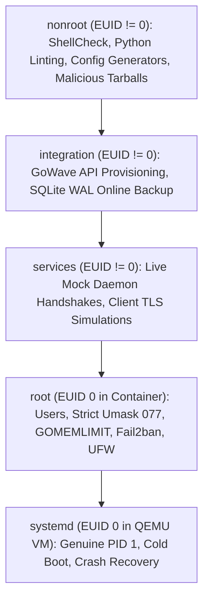
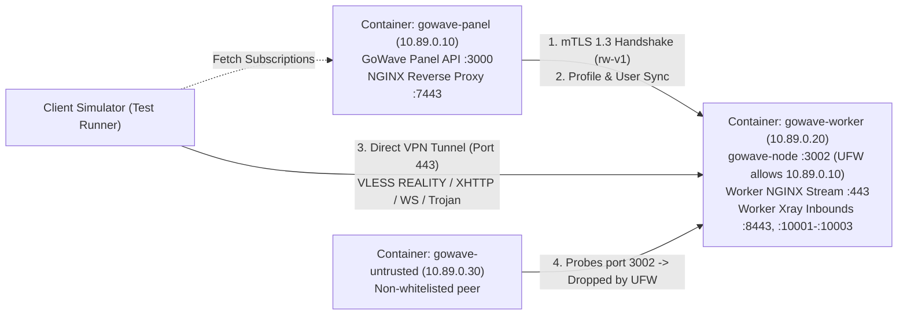

# Testing Strategy & CI Architecture: GoWave Auto NGINX

**Document Status**: Authoritative Specification  
**Source Baseline**: `community-baseline/tests/run_ci.py` (`community-baseline`) and `gowave-node/tests/`  
**Purpose**: Define the 5-suite testing architecture, runner contract, EUID privilege separation, test matrix, and acceptance gates for GoWave Auto NGINX.

---

## 1. Test Runner Contract & Privilege Separation

GoWave Auto NGINX adopts the exact test runner architecture of `community-baseline/tests/run_ci.py`. The runner verifies test completeness dynamically and enforces strict process EUID privileges before running any suite:

```bash
# Verify test inventory and completeness (zero unassigned or stale TestCase classes)
python3 tests/run_ci.py --check-completeness

# Run specific suite
python3 tests/run_ci.py --suite <name>

# Official OpenSpec strict validation (version 1.16.1)
openspec validate --all --strict
# or target specific change:
openspec validate gowave-auto-nginx --strict
```

### Privilege Context Enforcement

| Suite Name | Permitted EUID | Required Execution Environment | Forbidden Operations |
|---|---|---|---|
| **`nonroot`** | `os.geteuid() != 0` (Unprivileged) | Bare host or unprivileged container (`--user 1001:1001`) | Any `sudo`, filesystem mutation outside `/tmp`, network binds < 1024 |
| **`integration`**| `os.geteuid() != 0` (Unprivileged) | Bare host or unprivileged container (`--user 1001:1001`) | Systemd modifications, real firewall/iptables changes |
| **`services`** | `os.geteuid() != 0` (Unprivileged) | Mock container / local unprivileged environment (`--user 1001:1001`) | Host network manager changes, host DNS changes |
| **`root`** | `os.geteuid() == 0` (Root) | **Disposable throwaway container ONLY** | Bare host execution; changes to developer's host OS |
| **`systemd`** | `os.geteuid() == 0` (Root inside VM) | **QEMU TCG Virtual Machine with genuine PID 1 systemd** | Direct container execution lacking genuine systemd |

If `run_ci.py` is invoked with an incorrect EUID, it immediately terminates with code 1 and outputs:
```text
PRIVILEGE: FAIL — <suite> requires EUID 0 (or EUID != 0)
```

---

## 2. Test Suites & Verification Contracts



### Suite 1: `nonroot` (L1 Static Linting & Unit Logic)
- **Privilege**: Strictly non-root (`id -u != 0`).
- **Tests Covered**:
  - `test_shellcheck`: ShellCheck on all bash scripts (`SC1090`, `SC1091` ignored where appropriate).
  - `test_python_lint`: `flake8` and `mypy` on management Python utilities.
  - `test_scripts_py`: Execution of `python3 tests/test_scripts.py` verifying CLI script arguments and basic handlers.
  - `test_openspec`: OpenSpec CLI validation (`openspec validate --all --strict` / `openspec validate gowave-auto-nginx --strict`).
  - `test_nginx_generator`: NGINX Stream and HTTP configuration generator tests evaluating runtime version detection (`nginx -v`): validates `listen ... ssl http2;` for NGINX < 1.25.1 (Ubuntu 24.04 with 1.24.0, Debian 12 with 1.22.1) and `listen ...; http2 on;` for NGINX >= 1.25.1 (Debian 13 with 1.26.3, Ubuntu 26.04), verifying syntax with `nginx -t`.
  - `test_archive_security`: Malicious tarball injection tests verifying rejection of `../` path traversals, leading `/`, symlinks escaping managed roots, device nodes, and FIFOs.
  - `test_node_secret_parser`: Unit tests verifying base64 `SECRET_KEY` parsing and HKDF-SHA256 SNI derivation (`rw-v1`).
  - `test_nginx_conflict_scanner`: Unit tests scanning test `/etc/nginx/` trees with mock virtual hosts; asserts correct detection and reporting of unmanaged `listen ... 443` directives.
  - `test_remote_payload_generator`: Unit tests verifying SSH stdin payload generation (packing variables via `declare -p` and modular shell functions via `declare -f`) for remote worker deployment without file transfer dependencies.

### Suite 2: `integration` (L3 Inter-Process Contracts & Online Backup)
- **Privilege**: Non-root (`id -u != 0`).
- **Execution Harness & Fixture Strategy (AUD-11)**:
  - Runs in a disposable container under unprivileged UID (`--user 1001:1001`).
  - Spawns a real, native `gowave-server` instance backed by tmpfs-isolated SQLite (`DATABASE_URL=/tmp/test-gowave-$$.db`).
  - Bootstraps admin credentials dynamically via `POST /api/auth/register` (`username: "admin"`, `password: "testPassword123!"`).
  - Request/response validation utilizes static JSON fixtures in `tests/fixtures/api/` representing canonical DTO schemas.
- **Tests Covered**:
  - `test_sqlite_online_backup`: Continuous write transactions executed concurrently while `sqlite3 <db> ".backup <dest>"` executes; verify destination database passes `PRAGMA integrity_check;` with 100% data consistency.
  - `test_gowave_api_auth`: GoWave API admin bootstrap: query `/api/auth/status`, register initial admin via `POST /api/auth/register`, login via `POST /api/auth/login`, and verify JWT token issuance.
  - `test_profile_provisioning`: Authenticated creation of single unified Config Profile via `POST /api/config-profiles` containing all 4 inbounds, retrieving the 4 generated inbound UUIDs via `GET /api/config-profiles/{uuid}/inbounds`, and verifying `GET /api/config-profiles/{uuid}/computed-config`.
  - `test_computed_config_validation`: Queries `GET /api/config-profiles/{uuid}/computed-config` and verifies explicit validation checklist (AUD-09): HTTP status is 200, `response.config` is valid JSON, no top-level `error` or `message` fields, `inbounds` array contains exactly 4 elements, `streamSettings.security` is populated for all inbounds, REALITY settings with valid keys exist on port 8443, `acceptProxyProtocol` is omitted/false on internal inbounds (10001-10003), inbound tags are unique per node (`*-<node-name>`), and routing rules ensure GoWave Node API management rule (`GOWAVE_NODE_API`) takes precedence over loopback SSRF blocking.
  - `test_node_association`: Verification of linking single unified profile and all 4 inbounds to node via `POST /api/nodes` or `PATCH /api/nodes/{uuid}` with `{"configProfile": {"activeConfigProfileUuid": "<uuid>", "activeInbounds": [...]}}`.
  - `test_profile_cross_membership_negative`: Deliberately attempts to associate an inbound UUID belonging to a different Config Profile into `configProfile.activeInbounds`; asserts GoWave rejects the transaction with error `inbound X does not belong to config profile Y` without mutating the Node.
  - `test_internal_squad_and_user_sync`: Automated creation of managed Internal Squad via `POST /api/internal-squads` with 4 inbounds, creation of user via `POST /api/users` with squad assignment, and assertion that `syncUserToSingleNode` dispatches credentials to the Node for all 4 inbounds.
  - `test_host_provisioning`: Automated creation of Host records via `POST /api/hosts` for each MVP protocol with `"nodes": ["<node-uuid>"]`, `"internalSquads"`, and verified `securityLayer` (`DEFAULT` for REALITY, `TLS` for XHTTP, WS, and Trojan gRPC), followed by read-back verification via `GET /api/hosts` confirming node and squad relations.
  - `test_subscription_user_agent`: Verification that requests with valid client User-Agents (`v2rayN`, `ClashMeta`) return HTTP 200, while requests with missing or empty User-Agent return HTTP 403 Forbidden.
  - `test_response_rules_and_templates`: Verification that `DisableSubscriptionAccessByPath=false` in GoWave database and default templates (`MIHOMO` and `XRAY_JSON`) are seeded and intact.
  - `test_x25519_api_generation`: Integration test verifying Curve25519 keypair generation via `GET /api/system/tools/x25519/generate` returning valid base64 `privateKey` and `publicKey`.
  - `test_api_token_generation`: Integration test verifying long-lived token creation via `POST /api/tokens` with granular scopes (`subscription-page-configs:*`, `subscriptions:subpage-config`, `users:by-username`) and secure credential file creation at `/root/gowave-credentials.txt` with mode `0600`.
  - `test_mtls_handshake`: Go test vectors validating Node mTLS 1.3 handshake with derived HKDF SNI and RS256 JWT bearer token against mock TLS server.

### Suite 3: `services` (L4 Live Services & Protocol Simulation)
- **Privilege**: Non-root (`id -u != 0`).
- **Tests Covered**:
  - `test_reality_fallback`: Legitimate REALITY client handshake vs scanner probe; verify fallback sends PROXY protocol v1 to port 9443 where decoy static site is served.
  - `test_xhttp_streaming`: Bidirectional HTTP/1.1 and HTTP/2 POST stream sent to `https://panel_domain/<xhttp_path>/`; verify NGINX reverse proxies to loopback port without chunk buffering or request body truncation.
  - `test_websocket_upgrade`: Verification of WebSocket handshake and protocol upgrade headers.
  - `test_trojan_grpc`: Live client test connecting to Trojan gRPC over HTTP/2 with password authentication, `grpc_pass` proxying to 10003, and bidirectional data transfer.
  - `test_xray_subscription`: Fetch `GET /api/sub/{shortUuid}/v2ray-json` with Xray UA; verify explicit assertion checklist (AUD-08): `status_code == 200`, `len(body.strip()) > 0`, body parses as valid JSON with `len(inbounds) >= 4`, all 4 inbounds present on port 443, and zero loopback/internal leaks (`127.0.0.1`, internal ports, unix sockets).
  - `test_mihomo_subscription`: Fetch `GET /api/sub/{shortUuid}/mihomo` with Mihomo UA; verify explicit assertion checklist (AUD-08): `status_code == 200`, `Content-Type: text/yaml`, `len(body.strip()) > 0`, body parses as valid YAML matching `assets/mihomo/expected.yaml` structure with `len(proxies) >= 4`, and zero internal leaks.
  - `test_client_import_validators`: Pass fetched Xray JSON to official Xray core (`v24.11.30`+ / `v25.x` via `xray run -test -c`) and Mihomo YAML to official Mihomo core (`v1.19.22`+ / `v1.20.0`+ via `mihomo -t -f`), asserting exit code 0 and verifying all proxy fields (type, server, port, cipher, password, uuid, flow, tls, sni, alpn, reality-opts, grpc-opts, ws-opts, xhttp-opts).
  - `test_outbound_ssrf_block`: Execute client connections through the provisioned proxy tunnel to `127.0.0.1:3000`, `127.0.0.1:3001`, `127.0.0.1:3002`, `169.254.169.254`, and RFC1918 addresses; assert that Xray routing drops or terminates connections with blackhole/rejection, proving zero loopback leakage.

### Suite 4: `root` (L2 Filesystem Permissions, Firewall & Edge Ports)
- **Privilege**: Root (`id -u == 0`) inside disposable container or VM.
- **Tests Covered**:
  - `test_user_permissions`: Creation of user `gowave:gowave`, verify directory permissions `1770 root:gowave` on `/opt/gowave`, and verify executable is owned by `root:root`.
  - `test_service_install`: Execution of `gowave-server service install /opt/gowave` and verification of generated `90-unprivileged.conf` and `gowave-update.path`.
  - `test_secret_delivery`: Delivery of `SECRET_KEY` strictly via stdin or temporary `0600` file; assert process inspection of both local `ssh` process and remote runner via `/proc/<pid>/cmdline` and `ps aux` reveals zero secrets.
  - `test_fail2ban_syntax`: Validation of `/etc/fail2ban/jail.d/90-gowave-auto-nginx.local` via `fail2ban-client --test`.
  - `test_backup_format_v1`: Generation of `GoWave Auto NGINX Backup Format v1` archive; verify mode `0600` and validation of `meta.json` manifest.
  - `test_stream_sni_routing`: NGINX Stream routing port 443 into `panel_domain` (7443) and `reality_domain` (8443).
  - `test_worker_edge_traffic`: Live client test connecting directly to remote Worker node on port 443 across all 4 protocols, validating Worker NGINX Stream, TLS termination, and direct data tunneling without traversing Central Panel.
  - `test_node_firewall_isolation`: Verify that external IPv4 (`<public-ipv4>:3002`) and IPv6 (`[<public-ipv6>]:3002`) probes are dropped by UFW firewall rules, while local loopback connections succeed, verify active UFW status enforcement, and verify fail-closed behavior.
  - `test_certbot_renewal_dry_run`: Execute `certbot renew --dry-run` while NGINX is actively serving traffic on port 80/443; assert exit code 0, verifying webroot authenticator persistence. In CI container testbeds (Podman), tests execute against a local Pebble ACME server fixture (`pebble -config test/config/pebble-config.json`); live Let's Encrypt staging dry-runs are reserved for full acceptance VM/QEMU runs.
  - `test_decoy_tls13_h2`: Verify via `openssl s_client -tls1_3 -alpn h2 -connect 127.0.0.1:9443` that the fallback decoy vhost negotiates TLS 1.3 and ALPN HTTP/2.
  - `test_backup_restore_preflight_security`: Feed malicious tar archives to the 15-point preflight validator: including traversal (`../`), broad directories (`etc/letsencrypt/renewal-hooks/deploy/evil.sh`, `etc/nginx/modules-enabled/evil.conf`, `etc/systemd/system/gowave-node.service.d/evil.conf`), shell scripts, unauthorized binaries (`opt/gowave/gowave-server`, `opt/gowave-node/*`), SUID binaries, and oversized manifests; assert immediate fatal rejection before extracting any files.
  - `test_multi_node_sequential_add`: Execute sequential `gowave-auto.sh node add` operations; assert dedicated worker profiles and canonical remarks (`<PROTO>@<node-name>`) are created without modifying or overwriting existing node hosts.
  - `test_backup_strict_umask`: Execute backup procedure when system umask is `077`; verify backup destination is created with explicit mode `0640` ownership `gowave:gowave` without EACCES.
  - `test_gomemlimit_applied`: Verify `gowave.service` has `GOMEMLIMIT=250MiB` applied in runtime via `systemctl show gowave.service -p Environment | grep GOMEMLIMIT=250MiB`, and verify swap activation on low-RAM hosts via `swapon --show` and mode `0600` on `/swapfile`.
  - `test_ipv6_disabled_stream`: Simulate disabled IPv6 environment (`net.ipv6.conf.all.disable_ipv6=1` / absence of `/proc/net/if_inet6`); verify NGINX Stream 443 and HTTP 80 omit `[::]` directives, binding strictly to IPv4 (`listen 443`, `listen 80`) and starting cleanly without `Address family not supported by protocol` errors.
  - `test_journal_schema_validation`: Feed malformed and corrupted `journal.json` to `gowave-auto.sh recover`; verify immediate abort without destructive rollbacks, followed by read-only API audit.

### Suite 5: `systemd` (L5 Genuine PID 1 Systemd in QEMU TCG Guest)
- **Privilege**: Root (`id -u == 0`) inside QEMU virtual machine.
- **Target OS Matrix**: Ubuntu 24.04 LTS, Ubuntu 26.04 LTS, Debian 12, Debian 13.
- **Tests Covered**:
  - `test_qemu_clean_install`: Clean installation in fresh OS image; verify all services (`gowave`, `gowave-node`, `nginx`, `fail2ban`) start and reach `active (running)`.
  - `test_qemu_port_conflict`: Preflight port conflict test: simulate busy port 3000, 3001, or 3002; verify installer detects conflicting process and aborts without altering system state.
  - `test_qemu_cold_reboot`: Execute `systemctl reboot`; verify all services, firewall rules, and DoT configurations persist and resume automatically.
  - `test_qemu_channel_switching`: Switch from Stable to Dev via `gowave-auto.sh channel dev`, verify health, then switch back from Dev to Stable via `gowave-auto.sh channel stable --force`, verifying pre-switch snapshot creation and health.
  - `test_qemu_update_rollback`: Trigger `gowave-auto.sh update` with simulated post-update migration crash; verify automatic rollback from `/var/lib/gowave-auto-nginx/recovery/` restores original operational state.
  - `test_qemu_power_loss_recovery`: Simulate hard power cut / SIGKILL during update transaction; verify journal state machine initiates recovery on subsequent boot.

---

## 3. GitHub Actions CI Pipeline Architecture

> [!NOTE]
> **Implementation Status (AUD-12)**: The GitHub Actions workflows listed below (`.github/workflows/*.yml`) and linter configuration files (`.shellcheckrc`) represent authoritative architectural specifications and are scheduled deliverables of Tasks 1.1, 1.3, and 13.1–13.3 (`[IMPLEMENTATION_PLANNED]`).

| Workflow File | Trigger Events | Required Suites & Tasks | Status Check Name | Permissions |
|---|---|---|---|---|
| `lint-and-nonroot.yml` | Push, Pull Request | Suite `nonroot`, ShellCheck, actionlint, completeness check | `lint-and-nonroot` | `contents: read` |
| `root-integration.yml` | Push, Pull Request | Suite `root` (EUID 0) & Suite `integration` (container `--user 1001:1001`, EUID != 0) | `root-integration` | `contents: read` |
| `systemd-acceptance.yml` | Schedule (daily), Manual dispatch | Suite `services` & Suite `systemd` across Ubuntu 24/26 & Debian 12/13 | `systemd-acceptance` | `contents: read`, `actions: write` |

---

## 4. Local Multi-Distribution Podman Testbed (Pre-Deployment VPS Gate)

To guarantee that deployment scripts and automation execute cleanly before deploying to a physical or cloud VPS, the repository provides an automated local testbed runner script: `tests/podman_testbed.sh`.

Podman provides containerized execution with genuine PID 1 `systemd` support (`--systemd=always --privileged`), eliminating the need to launch heavy QEMU virtual machines for fast, multi-distribution pre-flight checks.

### Target Distribution Matrix & Container Images

| Distribution Identifier | Target Operating System | Container Image | Container Init & Flags | Specific Adaptations Verified |
|---|---|---|---|---|
| `ubuntu24` | Ubuntu 24.04 LTS (Noble) | `docker.io/library/ubuntu:24.04` | PID 1 systemd 255.4 (`--systemd=always --privileged`) | NGINX 1.24.0 legacy HTTP/2 syntax (`listen ... ssl http2;`), UFW firewall loopback rules, native Panel/Node units |
| `ubuntu26` | Ubuntu 26.04 LTS (Resolute) | `docker.io/library/ubuntu:26.04` | PID 1 systemd 256+ (`--systemd=always --privileged`) | Modern NGINX HTTP/2 syntax (`http2 on;`), Stream multiplexing, UFW isolation |
| `debian12` | Debian 12 (Bookworm) | `docker.io/library/debian:12` | PID 1 systemd 252.30 (`--systemd=always --privileged`) | Auto-installation of `systemd-resolved`, NGINX 1.22.1 legacy syntax (`listen ... ssl http2;`), Debian security origins |
| `debian13` | Debian 13 (Trixie) | `docker.io/library/debian:13` | PID 1 systemd 256+ (`--systemd=always --privileged`) | Modern NGINX HTTP/2 syntax (`http2 on;`), systemd-resolved integration, Stream multiplexing |

### CLI Invocation Interface

```bash
# Run all 4 distributions sequentially in All-in-One topology and verify zero failures
./tests/podman_testbed.sh all

# Run multi-node distributed edge test (Panel + remote Worker across Podman bridge network)
./tests/podman_testbed.sh multi-node

# Or run individual distribution testbeds
./tests/podman_testbed.sh ubuntu24
./tests/podman_testbed.sh ubuntu26
./tests/podman_testbed.sh debian12
./tests/podman_testbed.sh debian13
```

### Container Launch Contract & Cgroups Configuration

Because official Docker Hub base images for Ubuntu and Debian lack `/sbin/init` and systemd packages, `podman_testbed.sh` builds a systemd-enabled container image via `tests/Containerfile.testbed` before execution:

```dockerfile
ARG BASE_IMAGE=docker.io/library/ubuntu:24.04
FROM ${BASE_IMAGE}
ENV DEBIAN_FRONTEND=noninteractive
RUN apt-get update && apt-get install -y --no-install-recommends \
    systemd systemd-sysv dbus python3 python3-systemd ufw fail2ban nginx libnginx-mod-stream sqlite3 curl tar gzip iproute2 ca-certificates openssh-server openssh-client \
    && apt-get clean && rm -rf /var/lib/apt/lists/*
STOPSIGNAL SIGRTMIN+3
CMD ["/sbin/init"]
```

`podman_testbed.sh` invokes Podman with specific volume mounts and systemd integration flags:
```bash
# Build testbed container image for target distribution
podman build -t "gowave-testbed-${DISTRO}:latest" --build-arg BASE_IMAGE="${BASE_IMAGE}" -f tests/Containerfile.testbed tests/

# Launch testbed container with PID 1 systemd
podman run --rm -d \
  --name "gowave-testbed-${DISTRO}" \
  --systemd=always \
  --privileged \
  -v "${WORKSPACE_ROOT}:/workspace:ro" \
  "gowave-testbed-${DISTRO}:latest"
```

### 8-Stage In-Container Verification Pipeline

Once the container reaches PID 1 `systemd` readiness, `podman_testbed.sh` executes the following 8 stages via `podman exec`:

1. **Stage 1: Base OS Detection & Prerequisite Provisioning**:
   - Detects OS release via `/etc/os-release`.
   - On Debian 12: explicitly verifies and executes automatic installation of `systemd-resolved`.
   - Installs base prerequisites (`curl`, `tar`, `sqlite3`, `socat`, `jq`, `openssl`, `ufw`, `fail2ban`, `nginx`).
2. **Stage 2: Runtime NGINX HTTP/2 Syntax Adaptation**:
   - Inspects `nginx -v` version string.
   - For NGINX < 1.25.1 (Ubuntu 24.04, Debian 12): verifies compiled configuration uses `listen 7443 ssl http2;`.
   - For NGINX >= 1.25.1 (Ubuntu 26.04, Debian 13): verifies compiled configuration uses `listen 7443 ssl;` and `http2 on;`.
   - Validates configuration integrity with `nginx -t`.
3. **Stage 3: Preflight Conflict Scanner Verification**:
   - Scans port availability for 3000, 3001, 3002, 7443, 8443, 9443, 443.
   - Simulates unmanaged NGINX virtual hosts listening on 443 and verifies installer detection and clean diagnostic abort.
4. **Stage 4: Systemd Service Bootstrap & Port Isolation**:
   - Boots `gowave.service` on loopback port 3000 (`APP_PORT=3000`).
   - Provisions `gowave-node.service` with drop-in `/etc/systemd/system/gowave-node.service.d/10-port.conf` enforcing port 3002.
   - Applies UFW firewall rules denying public ingress to 3002 while permitting loopback `127.0.0.1:3002` and `[::1]:3002`.
5. **Stage 5: GoWave REST API Provisioning & Native x25519 Keys**:
   - Bootstraps admin account via `POST /api/auth/register` and verifies JWT session.
   - Generates Curve25519 keypair via `GET /api/system/tools/x25519/generate`.
   - Creates single unified Config Profile with all 4 inbounds via `POST /api/config-profiles`.
   - Configures managed Internal Squad, associates user, and creates Host records (`POST /api/hosts`).
   - Generates scoped API tokens and records credentials to `/root/gowave-credentials.txt` with mode `0600`.
6. **Stage 6: NGINX Stream & Reverse Proxy Verification**:
   - Tests SNI dispatch on port 443 (`panel_domain` -> 7443, `reality_domain` -> 8443).
   - Validates Xray REALITY accepts PROXY protocol headers via `tcpSettings.acceptProxyProtocol: true`.
   - Validates XHTTP buffering disabled (`proxy_buffering off; proxy_request_buffering off;`) and logging disabled (`access_log off;`).
   - Validates WebSocket connection upgrade headers and Trojan gRPC proxying.
   - Sends scanner probes to port 8443 and verifies PROXY protocol v1 fallback to decoy website on 9443.
7. **Stage 7: Deterministic Subscription Delivery & Core Parser Validation**:
   - Fetches Xray JSON (`GET /api/sub/{shortUuid}/v2ray-json`) and validates schema using `xray run -test -c`.
   - Fetches Mihomo YAML (`GET /api/sub/{shortUuid}/mihomo`) and validates schema using `mihomo -t -f`, asserting `GEOIP,private,DIRECT,no-resolve` rule presence.
   - Asserts response headers `Subscription-Userinfo` and `profile-update-interval` are preserved.
   - Confirms zero loopback leaks (`127.0.0.1`, `localhost`, internal ports) across all delivered client profiles.
8. **Stage 8: Disaster Recovery & Rollback Simulation**:
   - Creates `GoWave Auto NGINX Backup Format v1` archive and verifies `0600` permissions.
   - Verifies SQLite operations execute under `runuser -u gowave`, pre-creates backup file with `install -m 0640` verifying success even under strict umask 077 (`test_backup_strict_umask`), and verifies systemd runtime environment application (`test_gomemlimit_applied`).
   - Injects simulated process failure into update transaction and asserts automatic rollback from `/var/lib/gowave-auto-nginx/recovery/` via `journal.json`.

### Multi-Node Distributed Edge E2E Pipeline (`tests/podman_testbed.sh multi-node`)

To test `gowave-node-auto.sh` and multi-node orchestration prior to VPS deployment, the testbed executes an end-to-end verification across an isolated Podman bridge network (`gowave-net`) with an untrusted client peer:



The multi-node test executes the following 6 stages:
1. **Network & 3-Container Provisioning**:
   - Creates Podman network `gowave-net` (subnet `10.89.0.0/24`).
   - Launches `gowave-panel` (`10.89.0.10`), `gowave-worker` (`10.89.0.20`), and `gowave-untrusted` (`10.89.0.30`) with `--systemd=always --privileged`.
2. **Control Plane Provisioning**:
   - Installs GoWave Panel on `gowave-panel`, verifies API listening on `127.0.0.1:3000` and NGINX on `10.89.0.10:7443`.
   - Bootstraps admin user, single unified Config Profile, and Host records.
3. **Remote Worker Deployment over SSH Stdin**:
   - Dispatches `gowave-node-auto.sh` to `gowave-worker` (`10.89.0.20`) via the SSH stdin pipeline (`remote_payload`), passing `NODE_PORT=3002` (recommended default port for distributed workers preventing host-level collisions; 3000 supported only for isolated worker containers), `SECRET_KEY`, `PANEL_IP=10.89.0.10`, `WORKER_DOMAIN`, and `REALITY_DOMAIN` without file transfer dependencies.
4. **Worker Firewall Lockdown Verification**:
   - Verifies UFW rule on Worker: `ufw allow proto tcp from 10.89.0.10 to any port 3002`.
   - Confirms that probes from `10.89.0.10` succeed, while probes from `gowave-untrusted` (`10.89.0.30`) to port 3002 are dropped.
5. **Panel-to-Node mTLS 1.3 Association & Config Push**:
   - Registers Worker node in Panel API via `POST /api/nodes` (`address: "10.89.0.20"`, `port: 3002`).
   - Initiates mTLS 1.3 handshake with HKDF-derived SNI (`rw-v1`), pushes inbounds, and syncs users via `syncUserToSingleNode`.
   - Verifies `gowave-node` receives configuration and supervises Xray core.
6. **Direct Edge Client Traffic & Camouflage Fallback**:
   - Simulates client connections directly to `10.89.0.20:443` across all 4 MVP protocols (VLESS REALITY, XHTTP, WebSocket, Trojan gRPC).
   - Verifies that client VPN traffic terminates and routes directly on `gowave-worker` without passing through `gowave-panel`.
   - Verifies PROXY protocol fallback to local camouflage site on `10.89.0.20:9443` for unauthorized probes.

### Pre-Deployment VPS Gate Rule

> [!IMPORTANT]
> **VPS Deployment Gate Requirement**: No changes to `gowave-auto.sh`, `gowave-node-auto.sh`, templates, or systemd configurations may be pushed to production branches or executed on physical/cloud VPS environments without passing both `./tests/podman_testbed.sh all` (All-in-One across all 4 operating systems) and `./tests/podman_testbed.sh multi-node` (Distributed Edge dual-container test).
