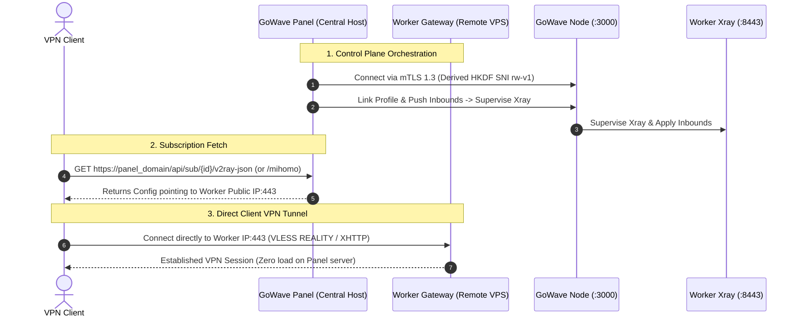

# Design: GoWave Auto NGINX

## Context

See `proposal.md` for background and motivation. GoWave is an AGPL-3.0 licensed system consisting of a Go backend, React frontend, SQLite storage, and Go-based worker nodes (`gowave-node`). The infrastructure community baseline project, `community-baseline` (GPL-3.0), provides battle-tested implementations of NGINX Stream multiplexing, transactional security hardening, and Backup/Restore mechanisms.

This design specifies the modular implementation of a standalone installer and lifecycle manager for GoWave, detailing the network architecture, deterministic subscription delivery, host provisioning, update lifecycle, edge node hardening, backup system, and testing pipeline.

Refer to `TECHNICAL_AUDIT.md` for verified upstream commit SHAs and technical facts, `COMPATIBILITY_MATRIX.md` for OS-level support, `TESTING_STRATEGY.md` for test suite specifications, and `RISKS_AND_OPEN_QUESTIONS.md` for scope boundaries.

---

## Component Ownership Matrix

```
+-------------------+----------------------------+-----------------------------------+---------------------------------------------------+
| Subsystem         | Supervising Process        | Primary Configuration / State     | Ownership Policy                                  |
+===================+============================+===================================+===================================================+
| GoWave Panel      | systemd: gowave.service    | /opt/gowave/.env, gowave.db       | Managed via gowave-server service install;        |
|                   |                            | (GOWAVE_PROXY=external)           | unprivileged gowave user; sticky bit 1770;        |
|                   |                            |                                   | orchestrated initially & updated by gowave-auto.sh|
+-------------------+----------------------------+-----------------------------------+---------------------------------------------------+
| GoWave Node       | systemd: gowave-node.service| /opt/gowave-node/.env, /run/...  | Installed via upstream gowave-node/install.sh;    |
|                   |                            |                                   | runs as root; orchestrated by gowave-node-auto.sh |
+-------------------+----------------------------+-----------------------------------+---------------------------------------------------+
| Xray-Core         | Child process of           | /run/gowave-node/xray.json,       | Supervised strictly by gowave-node ProcessManager.|
|                   | gowave-node daemon         | /run/gowave-node/xray.sock        | **No independent watchdog or external timer.**    |
+-------------------+----------------------------+-----------------------------------+---------------------------------------------------+
| NGINX Stream (443)| systemd: nginx.service     | /etc/nginx/stream-enabled/        | Installer owns Stream SNI map and public listener.|
+-------------------+----------------------------+-----------------------------------+---------------------------------------------------+
| NGINX Web (80/7443| systemd: nginx.service     | /etc/nginx/conf.d/gowave-*.conf   | Installer owns reverse proxy rules & ACME webroot.|
| / 9443)           |                            |                                   | (GOWAVE_PROXY=external ensures GoWave doesn't alter)|
+-------------------+----------------------------+-----------------------------------+---------------------------------------------------+
| TLS Certificates  | systemd: certbot.timer     | /etc/letsencrypt/live/            | Managed by Certbot; renewal reloads NGINX.        |
+-------------------+----------------------------+-----------------------------------+---------------------------------------------------+
| Firewall (UFW)    | systemd: ufw.service       | /etc/ufw/user.rules               | Installer configures rules, isolates Node port    |
|                   |                            |                                   | 3002 to loopback, and whitelists Panel IP.        |
+-------------------+----------------------------+-----------------------------------+---------------------------------------------------+
| Host Security     | fail2ban, systemd-resolved | /etc/fail2ban/, /etc/systemd/     | Project drop-in files with marker comments.       |
+-------------------+----------------------------+-----------------------------------+---------------------------------------------------+
| Updates           | gowave-auto.sh &           | /var/lib/gowave-auto-nginx/       | Preflight SQLite backup, persistent snapshot,     |
|                   | gowave-update.path         | recovery/                         | health verification, and auto-rollback on failure.|
+-------------------+----------------------------+-----------------------------------+---------------------------------------------------+
```

---

## Network Topologies: All-in-One vs. Distributed Edge

### Topology A: All-in-One Deployment (Primary MVP Target)
In Topology A, all services run on a single host. To prevent port collision:
- GoWave Panel API: `127.0.0.1:3000` (`APP_PORT=3000`)
- GoWave Metrics: `127.0.0.1:3001` (`METRICS_PORT=3001`)
- Local GoWave Node: binds wildcard `:3002` (`NODE_PORT=3002`), but is strictly isolated from external networks via UFW firewall rules (`ufw deny 3002/tcp`), permitting only loopback connections (`127.0.0.1`, `::1`).
- NGINX Stream (Port 443) inspects SNI: forwards `panel_domain` to local NGINX HTTPS (`127.0.0.1:7443`), and `reality_domain` or scanners to local Xray (`127.0.0.1:8443`).

```mermaid
graph TD
    Client["Client / Web Browser / Scanner"] -->|TCP 443| Stream["NGINX Stream (:443)"]
    Stream -->|SNI panel_domain (PROXY v1)| HTTPS["NGINX HTTPS (:7443)"]
    Stream -->|SNI reality_domain / default (PROXY v1)| XrayReality["Xray REALITY (:8443)"]
    
    HTTPS -->|Path / or /api/*| Panel["GoWave Panel (:3000)"]
    HTTPS -->|Path /<xhttp>/| XrayXHTTP["Xray XHTTP (:10001)"]
    HTTPS -->|Path /<ws>/| XrayWS["Xray WS (:10002)"]
    HTTPS -->|Path /<grpc>/| XrayGRPC["Xray gRPC (:10003)"]
    
    XrayReality -->|Scanner Fallback (PROXY v1)| Decoy["NGINX Decoy (:9443)"]
    Panel -->|mTLS 1.3 / JWT (Loopback only)| Node["GoWave Node (:3002, Firewalled)"]
    Node -->|Supervises / gRPC| XrayCore["Xray Core Process"]
```

### Topology B: Distributed Edge Deployment (Multi-Node Architecture)
In Topology B, the Central Server acts as the Control Plane, while one or more remote Worker Servers act as VPN edge gateways:
1. **Central Server (Control Plane)**:
   - Hosts GoWave Panel (`127.0.0.1:3000`), NGINX reverse proxy (`panel_domain:443`), and SQLite database.
   - Publishes user subscriptions containing the public addresses/ports of Worker Nodes.
   - Connects to remote Worker Nodes over mTLS 1.3 on `NODE_PORT` (default 3000) using derived HKDF SNI (`rw-v1`).
2. **Worker Server (Edge Gateway)**:
   - Has its own public IPv4/IPv6 and worker domain.
   - Runs `gowave-node` (installed via upstream `install.sh`) and Xray core, orchestrated via `gowave-node-auto.sh`.
   - Runs NGINX Stream on port 443 for REALITY camouflage fallback and local decoy site hosting.
   - UFW firewall allows public 443 (VPN traffic) and whitelists `PANEL_IP` strictly for `NODE_PORT` (3000) for both IPv4 and IPv6.
   - Clients connect **directly to the Worker Server** on port 443 for VPN tunneling. Client VPN data does NOT pass through the Central Panel.
3. **Central Edge Proxying (Topology C) is Formally Rejected**:
   - Proxying all client VPN data through the central panel introduces a fatal latency bottleneck, doubles bandwidth costs, and creates a single point of failure.



---

## Conflict-Free Port & Protocol Matrix (All-in-One Topology)

| Port | Protocol / Transport | Network Scope | Listener Process | PROXY Protocol In / Out | Purpose |
|---|---|---|---|---|---|
| **443** | TCP (TLS / Stream) | Public (`0.0.0.0/0`, `[::]`) | NGINX Stream | In: None / Out: **PROXY v1** | Public edge port; inspects SNI via `ssl_preread` |
| **80** | TCP (HTTP) | Public (`0.0.0.0/0`, `[::]`) | NGINX HTTP | In: None / Out: None | ACME HTTP-01 challenge (`/var/www/gowave-acme`) & 301 redirect to HTTPS |
| **7443** | TCP (TLS + HTTP/1.1, H2) | Loopback (`127.0.0.1`) | NGINX HTTPS | In: **PROXY v1** / Out: None | Terminates Let's Encrypt TLS for `panel_domain`; proxies web UI and inbounds |
| **8443** | TCP (REALITY / TLS RAW) | Loopback (`127.0.0.1`) | Xray REALITY Inbound | In: **PROXY v1** / Out: **PROXY v1** (on fallback) | Terminated by Xray REALITY; valid clients tunnel VPN; scanners fallback to 9443 |
| **9443** | TCP (TLS + HTTP/1.1) | Loopback (`127.0.0.1`) | NGINX Decoy Vhost | In: **PROXY v1** / Out: None | Terminates TLS for `reality_domain`; serves static camouflage website (`cover-reality`) |
| **3000** | TCP (Cleartext HTTP) | Loopback (`127.0.0.1`) | GoWave Panel Backend | In: None / Out: None | Panel REST API and static frontend assets (`APP_PORT=3000`) |
| **3001** | TCP (Cleartext HTTP) | Loopback (`127.0.0.1`) | GoWave Panel Metrics | In: None / Out: None | Prometheus metrics endpoint (optional, loopback only) |
| **3002** | TCP (mTLS 1.3) | Wildcard (`:3002`) isolated via UFW | Local GoWave Node | In: None / Out: None | Local Node control plane (`NODE_PORT=3002`); UFW denies external; zero collision |
| **10001**| TCP (Cleartext HTTP/1.1)| Loopback (`127.0.0.1`) | Xray XHTTP Inbound | In: None / Out: None | Internal backend inbound for VLESS-XHTTP |
| **10002**| TCP (Cleartext HTTP/WS) | Loopback (`127.0.0.1`) | Xray WS Inbound | In: None / Out: None | Internal backend inbound for VLESS-WS |
| **10003**| TCP (Cleartext gRPC) | Loopback (`127.0.0.1`) | Xray gRPC Inbound | In: None / Out: None | Internal backend inbound for Trojan-gRPC |

---

## Architectural Decisions

### Decision 1: Traffic Routing & Native Protocol Profiles

#### 4 Native MVP Protocol Profiles
The system provides verified templates and testing for exactly 4 native protocol profiles:
1. **VLESS + REALITY + Vision**:
   - `protocol: "vless"`, `security: "reality"`, `flow: "xtls-rprx-vision"`.
   - Incoming on port 443 Stream -> forwarded with PROXY v1 to Xray at `127.0.0.1:8443`.
   - Handshake authenticated via REALITY keys. Scanners forward with PROXY v1 (`dest: "127.0.0.1:9443", xver: 1`) to NGINX decoy vhost.
2. **VLESS + XHTTP + TLS**:
   - `protocol: "vless"`, `security: "none"`, `network: "xhttp"`.
   - Incoming on port 443 Stream (`panel_domain`) -> NGINX HTTPS listener at 7443 terminates TLS.
   - Location `^~ /<xhttp_path>/` reverse proxies to `http://127.0.0.1:10001` with `proxy_buffering off; proxy_request_buffering off; proxy_http_version 1.1;`.
3. **VLESS + WebSocket + TLS**:
   - `protocol: "vless"`, `security: "none"`, `network: "ws"`.
   - Incoming on port 443 Stream (`panel_domain`) -> NGINX HTTPS listener at 7443 terminates TLS.
   - Location `= /<ws_path>` proxies to `http://127.0.0.1:10002` preserving `Upgrade: websocket` headers.
4. **Trojan + gRPC + TLS**:
   - `protocol: "trojan"`, `security: "none"`, `network: "grpc"`.
   - Incoming on port 443 Stream (`panel_domain`) -> NGINX HTTPS listener at 7443 terminates TLS.
   - Location `/serviceName` passes HTTP/2 frames via `grpc_pass grpc://127.0.0.1:10003`.

#### Direct VLESS + TLS + Vision Deferral
Direct VLESS + TLS + Vision (without REALITY) requires Xray itself to terminate TLS, which requires Xray to directly read Let's Encrypt certificates. When Certbot renews the certificate, Xray must be reloaded/restarted across process boundaries. To keep the MVP reliable and avoid privilege boundary violations, direct VLESS + TLS + Vision is **deferred to post-MVP Non-Goals**.

#### Strict PROXY Protocol Boundaries
- **Sender**: NGINX Stream on port 443 sends PROXY protocol v1 to `127.0.0.1:7443` and `127.0.0.1:8443`.
- **Receiver**: NGINX listeners at 7443 and 9443 configure `proxy_protocol` and restrict trust strictly to loopback:
  ```nginx
  listen 127.0.0.1:7443 ssl proxy_protocol;
  set_real_ip_from 127.0.0.1;
  real_ip_header proxy_protocol;
  ```
- Any external attempt to inject fake PROXY protocol headers from non-loopback addresses is discarded.

---

### Decision 2: GoWave Subscriptions, Response Rules & Host Provisioning

#### Deterministic Per-User Subscription Links
GoWave supports route `GET /api/sub/{shortUuid}/{clientType}`. To eliminate dependency on ambiguous User-Agents or fallback rules, every user is provided two distinct, deterministic URLs:
1. **Xray Subscription URL**:
   - Route: `https://<public-domain>/api/sub/<shortUuid>/v2ray-json`
   - Maps to GoWave response type `XRAY_JSON`.
   - Header: `Content-Type: application/json`.
   - Contains all 4 MVP protocols in full Xray configuration JSON format.
2. **Mihomo Subscription URL**:
   - Route: `https://<public-domain>/api/sub/<shortUuid>/mihomo`
   - Maps to GoWave response type `MIHOMO`.
   - Header: `Content-Type: text/yaml`.
   - Contains all 4 MVP protocols formatted as Mihomo/Clash-Meta proxies in YAML format.

#### Response Rules & Template Integrity
- In `subscription_settings`, `DisableSubscriptionAccessByPath` must be `false` to permit the `:clientType` route.
- The `subscription_templates` database table must contain valid template records for `MIHOMO` (`DefaultTemplateMihomo`) and `XRAY_JSON` (`DefaultTemplateXrayJson`). If templates are absent, GoWave's `subtpl.Render` returns an empty string `""`. The installer verifies template presence and seeds them if missing.
- User-Agent matching rules remain active for generic requests to `/api/sub/<shortUuid>`, falling back gracefully.

#### Automatic GoWave Host Record Provisioning
In GoWave's data model, creating Config Profiles on a Node is not sufficient for client connections; client subscription links are generated from `Host` entities. For each provisioned MVP profile, the provisioning module creates a Host record via `POST /api/hosts`:
```json
{
  "inbound": {
    "configProfileUuid": "<profile-uuid>",
    "configProfileInboundUuid": "<inbound-uuid>"
  },
  "remark": "VLESS-REALITY-Vision",
  "address": "vpn.example.com",
  "port": 443,
  "sni": "www.apple.com",
  "path": null,
  "host": null,
  "alpn": "h2,http/1.1",
  "fingerprint": "chrome",
  "securityLayer": "REALITY",
  "isDisabled": false
}
```
- For XHTTP and WebSocket, `path` and `host` headers are populated.
- For Trojan gRPC, `path` is set to the gRPC service name and `securityLayer` to `DEFAULT`.
- Provisioning is idempotent: existing hosts with identical inbound associations are updated via `PATCH /api/hosts`, preventing duplicates.

#### Public Output & Zero Internal Leaks
- The installer displays both subscription links (`v2ray-json` and `mihomo`) in its completion summary report.
- Both links are displayed in the GoWave panel UI with one-click copy.
- Subscriptions are validated to contain strictly public domain/IP and port 443; loopback addresses (`127.0.0.1`, `::1`), internal ports (`3000`, `3001`, `3002`, `7443`, `8443`, `9443`, `10001-10003`), and node secrets are guaranteed never to appear in subscription output.

---

### Decision 3: Upstream Installers, Hardening & Service Management

#### GoWave Panel Native Service Installation
- The installer downloads Panel binaries and frontend assets with SHA256 checksum verification.
- Generates `/opt/gowave/.env` containing `GOWAVE_PROXY=external`.
- Executes native command:
  ```bash
  /opt/gowave/gowave-server service install /opt/gowave
  ```
- This upstream command creates unprivileged user `gowave:gowave`, sets sticky bit permissions (`1770 root:gowave`), writes `/etc/systemd/system/gowave.service.d/90-unprivileged.conf` with full systemd sandboxing (`ProtectSystem=strict`, `NoNewPrivileges=true`, `CapabilityBoundingSet=CAP_NET_BIND_SERVICE`), and sets up `gowave-update.path` and `gowave-update.service`.
- The installer does **NOT** duplicate manual `90-unprivileged.conf` generation, avoiding conflicts.

#### GoWave Node Upstream Installer Orchestration
- `gowave-node-auto.sh` utilizes the official upstream `gowave-node/install.sh` installer as its foundation.
- The orchestrator sets environment variables:
  ```bash
  export NODE_PORT=3002 # (or 3000 for remote workers)
  export GOWAVE_NODE_VERSION=latest
  export SECRET_KEY="<base64-payload>"
  ```
- Invokes upstream installer, which verifies checksums, creates `/etc/systemd/system/gowave-node.service`, manages runtime directories, and validates startup.
- Orchestrator configures UFW firewall rules:
  - On All-in-One: `ufw deny 3002/tcp` blocks external access to the wildcard listener; only loopback is permitted.
  - On Worker: `ufw allow from <PANEL_IP> to any port <NODE_PORT> proto tcp` whitelists the Control Plane IP (both IPv4 and IPv6), dropping all other external traffic.

#### Config Profile to Node Association API
The installer associates Config Profiles and active inbounds to nodes using GoWave's exact API contract:
```json
POST /api/nodes
or
PATCH /api/nodes/{uuid}
{
  "name": "worker-1",
  "address": "127.0.0.1",
  "port": 3002,
  "configProfile": {
    "activeConfigProfileUuid": "<profile-uuid>",
    "activeInbounds": [
      "<inbound-uuid-1>",
      "<inbound-uuid-2>",
      "<inbound-uuid-3>",
      "<inbound-uuid-4>"
    ]
  }
}
```
- GoWave automatically compiles the Xray config and dispatches it to `gowave-node`.

---

### Decision 4: Safe Channel Switching (Stable vs. Dev)

GoWave Auto NGINX implements a dedicated subcommand `gowave-auto.sh channel [stable|dev]`:
1. **Pre-switch Inspection**: Reads `GOWAVE_CHANNEL` in `/opt/gowave/.env`. If already on the requested channel, exits with status 0.
2. **Mandatory Persistent Snapshot**: Executes SQLite Online Backup (`sqlite3 /opt/gowave/gowave.db ".backup /var/lib/gowave-auto-nginx/recovery/pre-channel-switch-<ts>.db"`) and archives current binaries.
3. **Migration Warning Guard**: When switching from Dev to Stable, the manager displays an explicit warning that newer Dev database migrations cannot be reversed, requiring interactive confirmation or the `--force` flag.
4. **Asset Update & Checksum Verification**: Downloads release assets for the target channel from official GitHub releases (`aaaSaZaN/gowave`), validates SHA256 checksums, and updates `/opt/gowave/.env` (`GOWAVE_CHANNEL=<channel>`).
5. **Restart & Health Verification**: Restarts `gowave.service` and polls `http://127.0.0.1:3000/api/system/health` for 30 seconds.
6. **Automatic Rollback**: If health verification fails, the manager halts the service, restores the previous binary, database, and `.env` from the snapshot, restarts the service, and exits with code 1.

---

### Decision 5: Transaction-Safe Updates with Crash Recovery Journal

#### Update Execution Flow
1. **Preflight Check & SQLite Online Backup**:
   - Verify panel health via `GET http://127.0.0.1:3000/api/system/health`.
   - Execute `PRAGMA integrity_check;` on live database.
   - Execute `PRAGMA wal_checkpoint(TRUNCATE);` with a 5-second busy timeout.
   - Capture a consistent database snapshot using SQLite Online Backup API:
     ```bash
     sqlite3 /opt/gowave/gowave.db ".backup /var/lib/gowave-auto-nginx/recovery/update-<ts>/gowave.db"
     ```
   - Verify `PRAGMA integrity_check;` on the backup copy.
2. **Persistent Snapshot & Durable State Journal**:
   - Create directory `/var/lib/gowave-auto-nginx/recovery/update-<ts>/` (mode 0700).
   - Copy `/opt/gowave/.env`, binary `gowave-server`, and `frontend/dist/`.
   - Write state to journal file `/var/lib/gowave-auto-nginx/recovery/journal.json` using atomic write (`.tmp` + `fsync` + `rename`):
     ```json
     {"transaction_id": "update-<ts>", "state": "PREPARED", "target_version": "v1.2.4"}
     ```
3. **Staged Release Application**:
   - Update journal state to `"APPLYING"`.
   - Download release binary and frontend bundle to temporary directory.
   - Verify SHA256 checksums against official `SHA256SUMS`.
   - Atomically replace files in `/opt/gowave/`.
4. **Service Restart & Health Verification**:
   - Update journal state to `"VERIFYING"`.
   - Run `systemctl restart gowave`.
   - Poll healthcheck endpoint for 30 seconds (15 attempts, 2-second interval).
5. **Automatic Rollback on Failure**:
   - If healthcheck fails, update journal state to `"ROLLBACK_REQUIRED"`.
   - Stop `gowave.service`.
   - Restore database, `.env`, binary, and frontend from recovery snapshot.
   - Restart `gowave.service`, verify original service health, and update journal state to `"ROLLED_BACK"`.
6. **Commit & Snapshot Pruning**:
   - Upon successful healthcheck, update journal state to `"COMMITTED"`.
   - Retain the last 3 recovery snapshots (enforcing a 5 GB maximum storage ceiling), pruning older snapshots safely.

#### Reboot & Power Loss Recovery
If the server suffers a sudden power loss or kernel panic during an update:
- On system boot or when `gowave-auto.sh` is invoked, the script inspects `journal.json`.
- If the journal state is `APPLYING` or `ROLLBACK_REQUIRED`, the manager detects an interrupted transaction and automatically initiates rollback to the snapshot, restoring service stability.

---

### Decision 6: Zero-Leak Secret Delivery

- `SECRET_KEY` is extracted via `./gowave-server rescue --print-secret-key-raw`.
- When configuring `gowave-node`, the secret is delivered strictly via standard input (`stdin`) or written to a private temporary file with mode `0600` that is unlinked immediately after ingestion.
- The secret key is **never passed in CLI arguments** (`argv`), preventing credential exposure via `/proc/<pid>/cmdline` or `ps aux`.
- `SNI_VERIFICATION=true` is explicitly set in `/opt/gowave-node/.env`.

---

### Decision 7: Debian 12 Compatibility Layer

Debian 12 compatibility is achieved via three targeted adaptations:
1. **`systemd-resolved` Provisioning**:
   - Detected via `command -v resolvectl`. If missing and DoT is selected, runs `apt-get install -y systemd-resolved` and enables the unit.
2. **NGINX 1.22.1 HTTP/2 Syntax Adaptation**:
   - Evaluates `nginx -v`. For versions < 1.25.1 (Debian 12 has 1.22.1), renders:
     ```nginx
     listen 127.0.0.1:7443 ssl http2 proxy_protocol;
     ```
   - For versions >= 1.25.1 (Ubuntu 24.04/Debian 13), renders:
     ```nginx
     listen 127.0.0.1:7443 ssl proxy_protocol;
     http2 on;
     ```
3. **APT Security Origins**:
   - Configures `/etc/apt/apt.conf.d/99zz-gowave-auto-nginx` with `origin=Debian,label=Debian-Security,codename=${distro_codename}-security`.
   - Disables automatic reboots (`Unattended-Upgrade::Automatic-Reboot "false";`) by default.

---

### Decision 8: Backup Format v1 & Hardened Archive Validation

#### Format Identity & Structure
The archive format is formally designated as **GoWave Auto NGINX Backup Format v1**:
- Type: **UNENCRYPTED gzip archive (`.tar.gz`)**, protected by POSIX mode `0600` root-only permissions.
- Manifest `meta.json`:
  ```json
  {
    "format_version": 1,
    "created_at": "2026-11-07T12:00:00Z",
    "backup_type": "panel",
    "source_os": {"id": "ubuntu", "version_id": "24.04", "arch": "amd64"},
    "component_versions": {
      "gowave": "v1.2.4",
      "gowave_node": "v1.1.3",
      "xray": "v25.x",
      "nginx": "1.24.0"
    },
    "files": [
      {"path": "opt/gowave/gowave.db", "sha256": "...", "mode": "0640", "owner": "gowave", "group": "gowave"},
      {"path": "opt/gowave/.env", "sha256": "...", "mode": "0640", "owner": "root", "group": "gowave"}
    ]
  }
  ```

#### 12-Point Archive Preflight Security Validation
Before extracting any archive, a dedicated Python validator inspects all tar members:
1. Rejects member names containing directory traversal sequences (`..`).
2. Rejects absolute path member names (leading `/`).
3. Rejects symbolic links pointing outside designated managed roots.
4. Rejects hard links pointing to non-regular files.
5. Rejects FIFO, socket, block, or character device nodes.
6. Rejects archives with member counts exceeding 5,000 files.
7. Rejects archives whose unpacked size exceeds 1 GB (decompression bomb protection).
8. Rejects `meta.json` exceeding 16 KB.
9. Validates file SHA256 checksums against `meta.json`.
10. Validates OS and architecture compatibility against target host.
11. Restricts extraction strictly to a private staging directory (`mode 0700`).
12. Restores files atomically using temporary siblings and renames.
