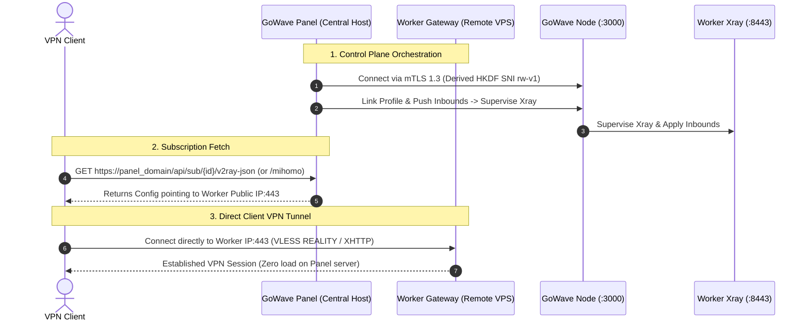

# Design: GoWave Auto NGINX

## Context

See `proposal.md` for background and motivation. GoWave is an AGPL-3.0 licensed system consisting of a Go backend, React frontend, SQLite storage, and Go-based worker nodes (`gowave-node`). The infrastructure community baseline project, `community-baseline` (GPL-3.0), provides battle-tested implementations of NGINX Stream multiplexing, transactional security hardening, and Backup/Restore mechanisms.

This design specifies the modular implementation of a standalone installer and lifecycle manager for GoWave, detailing the network architecture, deterministic subscription delivery, host provisioning, update lifecycle, edge node hardening, backup system, and testing pipeline.

Refer to `TECHNICAL_AUDIT.md` for verified upstream commit SHAs and technical facts, `COMPATIBILITY_MATRIX.md` for OS-level support, `TESTING_STRATEGY.md` for test suite specifications, and `RISKS_AND_OPEN_QUESTIONS.md` for scope boundaries.

---

## Component Ownership Matrix

```
+-------------------+----------------------------+-----------------------------------+---------------------------------------------------+
| Subsystem         | Supervising Process        | Primary Configuration / State     | Ownership Policy                                  |
+===================+============================+===================================+===================================================+
| GoWave Panel      | systemd: gowave.service    | /opt/gowave/.env, gowave.db       | Managed via gowave-server service install;        |
|                   |                            | (GOWAVE_PROXY=external)           | unprivileged gowave user; sticky bit 1770;        |
|                   |                            |                                   | orchestrated initially & updated by gowave-auto.sh|
+-------------------+----------------------------+-----------------------------------+---------------------------------------------------+
| GoWave Node       | systemd: gowave-node.service| /opt/gowave-node/.env, /run/...  | Installed via upstream gowave-node/install.sh;    |
|                   |                            |                                   | runs as root; orchestrated by gowave-node-auto.sh |
+-------------------+----------------------------+-----------------------------------+---------------------------------------------------+
| Xray-Core         | Child process of           | /run/gowave-node/xray.json,       | Supervised strictly by gowave-node ProcessManager.|
|                   | gowave-node daemon         | /run/gowave-node/xray.sock        | **No independent watchdog or external timer.**    |
+-------------------+----------------------------+-----------------------------------+---------------------------------------------------+
| NGINX Stream (443)| systemd: nginx.service     | /etc/nginx/stream-enabled/        | Installer owns Stream SNI map and public listener.|
+-------------------+----------------------------+-----------------------------------+---------------------------------------------------+
| NGINX Web (80/7443| systemd: nginx.service     | /etc/nginx/conf.d/gowave-*.conf   | Installer owns reverse proxy rules & ACME webroot.|
| / 9443)           |                            |                                   | (GOWAVE_PROXY=external ensures GoWave doesn't alter)|
+-------------------+----------------------------+-----------------------------------+---------------------------------------------------+
| TLS Certificates  | systemd: certbot.timer     | /etc/letsencrypt/live/            | Managed by Certbot; renewal reloads NGINX.        |
+-------------------+----------------------------+-----------------------------------+---------------------------------------------------+
| Firewall (UFW)    | systemd: ufw.service       | /etc/ufw/user.rules               | Installer configures rules, isolates Node port    |
|                   |                            |                                   | 3002 to loopback, and whitelists Panel IP.        |
+-------------------+----------------------------+-----------------------------------+---------------------------------------------------+
| Host Security     | fail2ban, systemd-resolved | /etc/fail2ban/, /etc/systemd/     | Project drop-in files with marker comments.       |
+-------------------+----------------------------+-----------------------------------+---------------------------------------------------+
| Updates           | gowave-auto.sh &           | /var/lib/gowave-auto-nginx/       | Preflight SQLite backup, persistent snapshot,     |
|                   | gowave-update.path         | recovery/                         | health verification, and auto-rollback on failure.|
+-------------------+----------------------------+-----------------------------------+---------------------------------------------------+
```

---

## Network Topologies: All-in-One vs. Distributed Edge

### Topology A: All-in-One Deployment (Primary MVP Target)
In Topology A, all services run on a single host. To prevent port collision:
- GoWave Panel API: `127.0.0.1:3000` (`APP_PORT=3000`)
- GoWave Metrics: `127.0.0.1:3001` (`METRICS_PORT=3001`)
- Local GoWave Node: binds wildcard `:3002` (`NODE_PORT=3002`), but is strictly isolated from external networks via UFW firewall rules (`ufw deny 3002/tcp`), permitting only loopback connections (`127.0.0.1`, `::1`).
- NGINX Stream (Port 443) inspects SNI: forwards `panel_domain` to local NGINX HTTPS (`127.0.0.1:7443`), and `reality_domain` or scanners to local Xray (`127.0.0.1:8443`).

```mermaid
graph TD
    Client["Client / Web Browser / Scanner"] -->|TCP 443| Stream["NGINX Stream (:443)"]
    Stream -->|SNI panel_domain (PROXY v1)| HTTPS["NGINX HTTPS (:7443)"]
    Stream -->|SNI reality_domain / default (PROXY v1)| XrayReality["Xray REALITY (:8443)"]
    
    HTTPS -->|Path / or /api/*| Panel["GoWave Panel (:3000)"]
    HTTPS -->|Path /<xhttp>/| XrayXHTTP["Xray XHTTP (:10001)"]
    HTTPS -->|Path /<ws>/| XrayWS["Xray WS (:10002)"]
    HTTPS -->|Path /<grpc>/| XrayGRPC["Xray gRPC (:10003)"]
    
    XrayReality -->|Scanner Fallback (PROXY v1)| Decoy["NGINX Decoy (:9443)"]
    Panel -->|mTLS 1.3 / JWT (Loopback only)| Node["GoWave Node (:3002, Firewalled)"]
    Node -->|Supervises / gRPC| XrayCore["Xray Core Process"]
```

### Topology B: Distributed Edge Deployment (Multi-Node Architecture)
In Topology B, the Central Server acts as the Control Plane, while one or more remote Worker Servers act as VPN edge gateways:
1. **Central Server (Control Plane)**:
   - Hosts GoWave Panel (`127.0.0.1:3000`), NGINX reverse proxy (`panel_domain:443`), and SQLite database.
   - Publishes user subscriptions containing the public addresses/ports of Worker Nodes.
   - Connects to remote Worker Nodes over mTLS 1.3 on `NODE_PORT` (default 3000) using derived HKDF SNI (`rw-v1`).
2. **Worker Server (Edge Gateway & Complete Traffic Plane)**:
   - Has its own public IPv4/IPv6 address and dedicated worker FQDN (`worker_domain`).
   - Runs `gowave-node` (installed via upstream `install.sh`) and Xray core, orchestrated via `gowave-node-auto.sh`.
   - Runs **full NGINX edge traffic plane**:
     - NGINX Stream on public port 443 (`ssl_preread on; proxy_protocol on;`) demultiplexing incoming connections: `worker_domain` SNI to local NGINX HTTPS listener (`127.0.0.1:7443`), camouflage SNI to local Xray REALITY inbound (`127.0.0.1:8443`), and unrecognized/scanner probes to 8443 (which fall back to local decoy vhost on 9443).
     - NGINX HTTPS listener on `127.0.0.1:7443` terminating Let's Encrypt TLS for `worker_domain`, with reverse proxy locations for XHTTP (`127.0.0.1:10001` with `proxy_buffering off;`), WebSocket upgrade (`127.0.0.1:10002`), and Trojan gRPC (`127.0.0.1:10003` via `grpc_pass`).
     - Certbot automated ACME HTTP-01 challenge on port 80 with deployment reload hook for NGINX.
   - UFW firewall permits public ports 80 and 443, and strictly whitelists `PANEL_IP` for `NODE_PORT` (default 3000) across both IPv4 and IPv6.
   - Clients connect **directly to the Worker Server** on port 443 for all 4 MVP VPN transports. Client VPN data does NOT pass through the Central Panel.
3. **Central Edge Proxying (Topology C) is Formally Rejected**:
   - Proxying all client VPN data through the central panel introduces a fatal latency bottleneck, doubles bandwidth costs, and creates a single point of failure.



---

## Conflict-Free Port & Protocol Matrix (All-in-One Topology)

| Port | Protocol / Transport | Network Scope | Listener Process | PROXY Protocol In / Out | Purpose |
|---|---|---|---|---|---|
| **443** | TCP (TLS / Stream) | Public (`0.0.0.0/0`, `[::]`) | NGINX Stream | In: None / Out: **PROXY v1** | Public edge port; inspects SNI via `ssl_preread` |
| **80** | TCP (HTTP) | Public (`0.0.0.0/0`, `[::]`) | NGINX HTTP | In: None / Out: None | ACME HTTP-01 challenge (`/var/www/gowave-acme`) & 301 redirect to HTTPS |
| **7443** | TCP (TLS + HTTP/1.1, H2) | Loopback (`127.0.0.1`) | NGINX HTTPS | In: **PROXY v1** / Out: None | Terminates Let's Encrypt TLS for `panel_domain`; proxies web UI and inbounds |
| **8443** | TCP (REALITY / TLS RAW) | Loopback (`127.0.0.1`) | Xray REALITY Inbound | In: **PROXY v1** / Out: **PROXY v1** (on fallback) | Terminated by Xray REALITY; valid clients tunnel VPN; scanners fallback to 9443 |
| **9443** | TCP (TLS + HTTP/1.1) | Loopback (`127.0.0.1`) | NGINX Decoy Vhost | In: **PROXY v1** / Out: None | Terminates TLS for `reality_domain`; serves static camouflage website (`cover-reality`) |
| **3000** | TCP (Cleartext HTTP) | Loopback (`127.0.0.1`) | GoWave Panel Backend | In: None / Out: None | Panel REST API and static frontend assets (`APP_PORT=3000`) |
| **3001** | TCP (Cleartext HTTP) | Loopback (`127.0.0.1`) | GoWave Panel Metrics | In: None / Out: None | Prometheus metrics endpoint (optional, loopback only) |
| **3002** | TCP (mTLS 1.3) | Wildcard (`:3002`) isolated via UFW | Local GoWave Node | In: None / Out: None | Local Node control plane (`NODE_PORT=3002`); UFW denies external; zero collision |
| **10001**| TCP (Cleartext HTTP/1.1)| Loopback (`127.0.0.1`) | Xray XHTTP Inbound | In: None / Out: None | Internal backend inbound for VLESS-XHTTP |
| **10002**| TCP (Cleartext HTTP/WS) | Loopback (`127.0.0.1`) | Xray WS Inbound | In: None / Out: None | Internal backend inbound for VLESS-WS |
| **10003**| TCP (Cleartext gRPC) | Loopback (`127.0.0.1`) | Xray gRPC Inbound | In: None / Out: None | Internal backend inbound for Trojan-gRPC |

#### Preflight Port & NGINX Configuration Conflict Inspection
To guarantee collision-free deployment:
1. **Socket Inspection**: The preflight module verifies active TCP listeners on ports 80, 443, 3000, 3001, 3002, 7443, 8443, 9443, 10001, 10002, and 10003 via `ss -Hltnp "sport = :<port>"`. If occupied by non-project processes, installation halts with conflicting process name and PID before mutating any system state.
2. **NGINX Configuration Inspection**: Port 443 is exclusively dedicated to the top-level NGINX `stream` block. The preflight module scans `/etc/nginx/` (excluding project-managed files) for conflicting `listen ... 443` directives:
   ```bash
   grep -rqsE --exclude="gowave-*.conf" --exclude="gowave-stream.conf" '^[[:space:]]*listen[[:space:]]+([^;]*:)?443[^0-9]' /etc/nginx/
   ```
   If unmanaged web server blocks listening on 443 are found, the installer detects the conflict and informs the operator to relocate existing HTTP SSL sites before applying the Stream configuration.

---

## Architectural Decisions

### Decision 1: Traffic Routing & Native Protocol Profiles

#### 4 Native MVP Protocol Profiles
The system provides verified templates and testing for exactly 4 native protocol profiles:
1. **VLESS + REALITY + Vision**:
   - `protocol: "vless"`, `security: "reality"`, `flow: "xtls-rprx-vision"`.
   - Incoming on port 443 Stream -> forwarded with PROXY v1 to Xray at `127.0.0.1:8443`.
   - Handshake authenticated via REALITY keys. The installer generates cryptographic x25519 keypairs natively via GoWave Panel REST API `GET /api/system/tools/x25519/generate`, obtaining verified `privateKey` and `publicKey` without external binary dependencies.
   - Scanners forward with PROXY v1 (`dest: "127.0.0.1:9443", xver: 1`) to NGINX decoy vhost.
2. **VLESS + XHTTP + TLS**:
   - `protocol: "vless"`, `security: "none"`, `network: "xhttp"`.
   - Incoming on port 443 Stream (`panel_domain`) -> NGINX HTTPS listener at 7443 terminates TLS.
   - Location `^~ /xhttp-down/` (and `^~ /xhttp-up/` for duplex mode) reverse proxies to `http://127.0.0.1:10001` with complete streaming directives:
     ```nginx
     location ^~ /xhttp-down/ {
         proxy_pass http://127.0.0.1:10001;
         proxy_http_version 1.1;
         proxy_buffering off;
         proxy_request_buffering off;
         proxy_read_timeout 1h;
         proxy_send_timeout 1h;
         proxy_set_header Host $host;
         proxy_set_header X-Real-IP $remote_addr;
         proxy_set_header X-Forwarded-For $proxy_add_x_forwarded_for;
     }
     ```
   - Canonical Xray template: `assets/xray/vless-xhttp.json`.
3. **VLESS + WebSocket + TLS**:
   - `protocol: "vless"`, `security: "none"`, `network: "ws"`.
   - Incoming on port 443 Stream (`panel_domain`) -> NGINX HTTPS listener at 7443 terminates TLS.
   - Location `= /ws` proxies to `http://127.0.0.1:10002` preserving `Upgrade: websocket` headers (`proxy_set_header Upgrade $http_upgrade; proxy_set_header Connection "upgrade";`).
   - Canonical Xray template: `assets/xray/vless-ws.json`.
4. **Trojan + gRPC + TLS**:
   - `protocol: "trojan"`, `security: "none"`, `network: "grpc"`.
   - Incoming on port 443 Stream (`panel_domain`) -> NGINX HTTPS listener at 7443 terminates TLS.
   - Location `/trojan-grpc` passes HTTP/2 frames via `grpc_pass grpc://127.0.0.1:10003;` with `grpc_read_timeout 1h; grpc_send_timeout 1h;`.
   - Canonical Xray template: `assets/xray/trojan-grpc.json`.

#### Explicit SNI Roles and Camouflage Architectures
To prevent conflation between camouflage sites, management panels, and public VPN connection endpoints, exactly 5 distinct domain and SNI roles and 2 verified camouflage architectures are established:
1. **Host Address (`address`)**: The public IPv4/IPv6 address or resolvable FQDN of the edge server (`vpn.example.com` or Worker IP). Clients send TCP SYN packets to this address on port 443.
2. **REALITY Camouflage SNI (`reality_camouflage_sni` / `serverNames`)**: Domain configured in Xray `realitySettings.serverNames` and sent by the client in the TLS ClientHello SNI extension during REALITY handshakes.
3. **NGINX `ssl_preread` SNI Router**: NGINX Stream on port 443 evaluates `$ssl_preread_server_name`:
   - Matches `reality_camouflage_sni` -> forwards via PROXY v1 to Xray REALITY inbound (`127.0.0.1:8443`).
   - Matches `panel_domain` (or `worker_domain`) -> forwards via PROXY v1 to NGINX HTTPS listener (`127.0.0.1:7443`).
   - Missing SNI or unrecognized scanner probe -> forwards to `127.0.0.1:8443`, triggering REALITY fallback.
4. **Camouflage Architecture Options**:
   - **Mode A: Owned Camouflage Domain with Local Decoy (Primary MVP)**: Operator configures an owned secondary domain (`reality_domain`, e.g. `cdn.example.com`). Certbot issues a valid Let's Encrypt certificate for it. NGINX on loopback port 9443 terminates TLS presenting this authentic certificate and serves `cover-reality`. Xray REALITY uses `serverNames: ["cdn.example.com"]` and `dest: "127.0.0.1:9443", xver: 1`. Active probes receive valid certificates matching the SNI.
   - **Mode B: Third-Party SNI Stealing**: If an external third-party domain is chosen (e.g. `gateway.icloud.com`), `dest` is configured to `gateway.icloud.com:443` with `xver: 0`. Scanner probes are proxied directly to the genuine third-party server, returning authentic vendor certificates without self-signed certificate exposure.
5. **Decoy Web Site (`cover-reality`)**: An authentic multi-asset website (retained from `community-baseline` `cover-reality` under `/var/www/gowave-auto-nginx/cover-reality` including complete HTML, stylesheets, scripts, and media assets) served on loopback port `9443` by NGINX. Minimal single-file HTML stubs are explicitly rejected to provide realistic camouflage against active probing and DPI scanners.

#### 3-Stage Let's Encrypt TLS Bootstrapping
To resolve the initial chicken-and-egg bootstrap deadlock (NGINX failing `nginx -t` due to missing certificate files before Certbot runs, while Certbot requires a running web server on port 80 to answer ACME HTTP-01 challenges):
1. **Stage 1 (Temporary ACME Webroot vhost)**: The installer writes `/etc/nginx/conf.d/00-bootstrap-acme.conf` listening exclusively on HTTP port 80 with root `/var/www/gowave-acme` and no SSL directives, and starts NGINX.
2. **Stage 2 (Certificate Acquisition)**: `certbot certonly --webroot -w /var/www/gowave-acme -d <domains>` acquires authentic Let's Encrypt certificates without port conflicts.
3. **Stage 3 (Production Transition)**: The installer unlinks `00-bootstrap-acme.conf`, writes production NGINX Stream 443 and HTTPS 7443 configurations referencing the issued certificates, and reloads NGINX (`systemctl reload nginx`).

#### Direct VLESS + TLS + Vision Deferral
Direct VLESS + TLS + Vision (without REALITY) requires Xray itself to terminate TLS, which requires Xray to directly read Let's Encrypt certificates. When Certbot renews the certificate, Xray must be reloaded/restarted across process boundaries. To keep the MVP reliable and avoid privilege boundary violations, direct VLESS + TLS + Vision is **deferred to post-MVP Non-Goals**.

#### Strict PROXY Protocol Boundaries
- **Sender**: NGINX Stream on port 443 sends PROXY protocol v1 to `127.0.0.1:7443` and `127.0.0.1:8443`.
- **Receiver (Xray)**: Inbound at `127.0.0.1:8443` strictly specifies `"tcpSettings": {"acceptProxyProtocol": true}`. When NGINX prepends the PROXY v1 header, Xray consumes it, restores the genuine client IP, and passes it to REALITY handshakes and fallback destinations.
- **Receiver (NGINX)**: NGINX listeners at 7443 and 9443 configure `proxy_protocol` and restrict trust strictly to loopback:
  ```nginx
  listen 127.0.0.1:7443 ssl proxy_protocol;
  set_real_ip_from 127.0.0.1;
  real_ip_header proxy_protocol;
  ```
- Any external attempt to inject fake PROXY protocol headers from non-loopback addresses is discarded.

---

### Decision 2: GoWave Subscriptions, Response Rules, Internal Squads & Host Provisioning

#### Unified Config Profile Architecture (Single Active Profile Constraint)
In upstream GoWave (`backend-go/internal/nodes/service.go`), `updateNodeWithProfile()` delegates to `createNodeInboundLinks()`, which enforces:
```go
if inbound.ProfileUUID != profileID {
    return fmt.Errorf("inbound %s does not belong to config profile %s", inbound.UUID, profileID)
}
```
A GoWave Node can have exactly ONE `activeConfigProfileUuid`, and **all active inbounds assigned to the node must belong to this single active profile**. Creating separate profiles for each protocol and attempting to link their inbound UUIDs to one node is rejected by upstream validation.

Therefore, for the All-in-One MVP:
1. The installer creates **ONE managed Config Profile** (named `"GoWave MVP Unified Profile"`) via `POST /api/config-profiles`, embedding all 4 inbounds inside its raw Xray JSON configuration:
   - Inbound 1: `protocol: "vless"`, `network: "tcp"`, `security: "reality"`, `port: 8443`
   - Inbound 2: `protocol: "vless"`, `network: "xhttp"`, `security: "none"`, `port: 10001`
   - Inbound 3: `protocol: "vless"`, `network: "ws"`, `security: "none"`, `port: 10002`
   - Inbound 4: `protocol: "trojan"`, `network: "grpc"`, `security: "none"`, `port: 10003`
2. Upon creation, GoWave parses the raw JSON and generates 4 `config_profile_inbounds` records.
3. The installer retrieves the 4 generated UUIDs via `GET /api/config-profiles/{uuid}/inbounds`.
4. The installer assigns the single profile UUID and all 4 inbound UUIDs to the node via `POST /api/nodes` or `PATCH /api/nodes/{uuid}` with `{"configProfile": {"activeConfigProfileUuid": "<single-profile-uuid>", "activeInbounds": ["<uuid1>", "<uuid2>", "<uuid3>", "<uuid4>"]}}`.
5. Idempotency: Existing managed profiles are updated via `PUT /api/config-profiles/{uuid}` without duplicating inbounds or breaking node links.

#### Internal Squad and User Lifecycle Provisioning
In upstream GoWave (`backend-go/internal/nodes/service.go`), `GetUserResolvedInbounds(userID)` constructs user inbounds strictly via relational joins:
`internal_squad_members` -> `internal_squads` -> `internal_squad_inbounds` -> `config_profile_inbounds`.
Subsequently, `syncUserToSingleNode()` sends user credentials to the Node only for inbounds linked through the squads of which the user is an active member. If a user is not in an Internal Squad or the squad has no inbound links, the Node receives ZERO user credentials for those inbounds.

To guarantee deterministic end-to-end credential sync:
1. **Managed Internal Squad Provisioning**: The installer creates a managed Internal Squad (`POST /api/internal-squads`):
   ```json
   {
     "name": "Default MVP Squad",
     "inbounds": [
       "<inbound-uuid-1>",
       "<inbound-uuid-2>",
       "<inbound-uuid-3>",
       "<inbound-uuid-4>"
     ]
   }
   ```
2. **Initial User Provisioning**: The installer provisions an initial active user via `POST /api/users`:
   ```json
   {
     "username": "default-user",
     "status": "ACTIVE",
     "trafficLimitStrategy": "NO_RESET",
     "activeInternalSquads": ["<squad-uuid>"]
   }
   ```
3. **Automated Credential Dispatch**: GoWave automatically executes `syncUserToSingleNode()`, transmitting user credentials (UUID, Trojan password) for all 4 inbounds to the Node.
4. **Subscription Short UUID**: The created user response contains `shortUuid`, which forms the deterministic subscription links.
5. If the operator subsequently creates users in the web panel, the setup documentation instructs them to assign the managed squad to receive all 4 protocols.

#### Deterministic Per-User Subscription Links & Response Rules Contract
GoWave supports route `GET /api/sub/{shortUuid}/{clientType}`. To eliminate dependency on ambiguous client sniffing, every user is provided two distinct, deterministic URLs:
1. **Xray Subscription URL**:
   - Route: `https://<public-domain>/api/sub/<shortUuid>/v2ray-json`
   - Maps to GoWave response type `XRAY_JSON`.
   - Header: `Content-Type: application/json`.
   - Contains all 4 MVP protocols in full Xray configuration JSON format.
2. **Mihomo Subscription URL**:
   - Route: `https://<public-domain>/api/sub/<shortUuid>/mihomo`
   - Maps to GoWave response type `MIHOMO`.
   - Header: `Content-Type: text/yaml` (or `text/yaml; charset=utf-8`).
   - Contains all client-compatible MVP protocols formatted as Mihomo/Clash-Meta proxies in YAML format.

#### Response Rules and User-Agent Enforcement (Option A)
- **Pinned Upstream Fact**: On pinned GoWave commit `6d2c35788b3b038627b5e86e6c6486caff0851c8`, `responseRules()` in `backend-go/internal/subscription/serve.go` executes for **both** `/api/sub/{shortUuid}` and `/api/sub/{shortUuid}/{clientType}`. If the `User-Agent` header is missing or empty, it returns `HTTP 403 Forbidden`:
  ```go
  if err != nil || settings.ResponseRules == nil || userAgent == nil || *userAgent == "" {
      nestError(w, r, http.StatusForbidden, "Forbidden")
      return nil
  }
  ```
  *(Note: The published web API documentation stated that the typed route bypasses Response Rules; however, the actual Go source code on this pinned commit executes responseRules for all subscription routes).*
- **Adopted Contract (Option A)**:
  - Clients requesting subscriptions must provide a non-empty, valid client User-Agent header (e.g. `v2rayN/6.23`, `Xray/1.8.4`, `ClashMeta/v1.18.0`, `Mihomo/1.18.0`).
  - In `subscription_settings`, `DisableSubscriptionAccessByPath` is verified as `false`.
  - The `subscription_templates` database table contains `DefaultTemplateMihomo` and `DefaultTemplateXrayJson`.
  - Tests verify that valid client User-Agents return HTTP 200, while missing or empty User-Agent returns HTTP 403 Forbidden (negative security test).

#### Automatic GoWave Host Record Provisioning & Verified Security Layers
Client subscription links are generated from `Host` entities in GoWave. For each provisioned MVP profile, the installer creates a Host record via `POST /api/hosts`:
```json
{
  "inbound": {
    "configProfileUuid": "<single-profile-uuid>",
    "configProfileInboundUuid": "<inbound-uuid>"
  },
  "nodes": ["<node-uuid>"],
  "remark": "VLESS-REALITY-Vision",
  "address": "vpn.example.com",
  "port": 443,
  "sni": "gateway.icloud.com",
  "path": null,
  "host": null,
  "alpn": "h2,http/1.1",
  "fingerprint": "chrome",
  "securityLayer": "DEFAULT",
  "internalSquads": {
    "mode": "ALLOW_ONLY",
    "squads": ["<squad-uuid>"]
  },
  "isDisabled": false
}
```

##### Upstream Host.securityLayer Resolution Contract
In `backend-go/internal/configprofiles/handler.go`, `formatHostResponse()` normalizes `securityLayer` to exactly 3 values: `DEFAULT`, `TLS`, `NONE`. Any other string (including `"REALITY"`) is converted to `"DEFAULT"`.

In `backend-go/internal/subtpl/resolve.go`, `resolveSecurity()` resolves client security:
- If `securityLayer == "TLS"`: forces client `security = "tls"`.
- If `securityLayer == "NONE"`: forces client `security = "none"`.
- If `securityLayer == "DEFAULT"`: inherits security from the inbound's stream settings.

| MVP Protocol Host | Inbound `streamSettings.security` | Host `securityLayer` | Resolved Client Security | Rationale |
|---|---|---|---|---|
| **VLESS REALITY Vision** | `reality` | `DEFAULT` | `reality` | Inherits `reality` from Xray inbound. `"REALITY"` is invalid enum; must be `"DEFAULT"`. |
| **VLESS XHTTP TLS** | `none` | `TLS` | `tls` | NGINX terminates TLS on 443/7443; Xray listens with `none`. Host must force `"TLS"` so client connects with TLS. |
| **VLESS WebSocket TLS** | `none` | `TLS` | `tls` | NGINX terminates TLS; Host must force `"TLS"`. |
| **Trojan gRPC TLS** | `none` | `TLS` | `tls` | NGINX terminates TLS; Host must force `"TLS"`. |

#### Web Panel UI vs. CLI Subscription Delivery (Scope Boundary)
- Upstream GoWave React frontend natively displays `user.subscriptionUrl` (the base subscription URL `https://<subPublicDomain>/<shortUuid>`).
- GoWave Auto NGINX explicitly **does NOT fork, rebuild, or patch the upstream React frontend bundle** in the MVP, avoiding frontend compilation fragility and maintenance divergence.
- The installer completion summary outputs both direct typed URLs (`/v2ray-json` and `/mihomo`).
- A CLI helper command `gowave-auto-nginx user links <username-or-shortUuid>` is provided to retrieve both typed URLs at any time.
- Subscriptions are validated to contain strictly public domain/IP and port 443; loopback addresses (`127.0.0.1`, `::1`), internal ports (`3000`, `3001`, `3002`, `7443`, `8443`, `9443`, `10001-10003`), node secrets, and private keys never appear in subscription output.

#### Scoped API Token Provisioning for External Web Frontends and Integrations
To enable seamless integration with external web subscription portals (such as `remnawave/subscription-page`) or Telegram management bots without exposing administrative passwords or granting raw database access, the installer automates token generation via `POST /api/tokens`:
```json
{
  "name": "gowave-auto-nginx subscription-page token",
  "description": "Generated by gowave-auto-nginx for external web subscription interfaces and integrations",
  "scopes": [
    "subscription-page-configs:list",
    "subscription-page-configs:get",
    "subscriptions:subpage-config",
    "system:metadata",
    "users:by-username"
  ],
  "expiresAt": null
}
```
The resulting Bearer token is appended along with the panel URL and administrative credentials to `/root/gowave-credentials.txt` with restricted permissions (`0600`).

---

### Decision 3: Upstream Installers, Hardening & Service Management

#### GoWave Panel Native Service Installation
- The installer downloads Panel binaries and frontend assets with SHA256 checksum verification.
- Generates `/opt/gowave/.env` containing `GOWAVE_PROXY=external`.
- Writes the base systemd unit `/etc/systemd/system/gowave.service` (`Type=simple`, `ExecStart=/opt/gowave/gowave-server`, `WorkingDirectory=/opt/gowave`, `After=network-online.target`).
- Executes the native command:
  ```bash
  /opt/gowave/gowave-server service install /opt/gowave
  ```
- This upstream command creates unprivileged user `gowave:gowave`, sets sticky bit permissions (`1770 root:gowave`), writes `/etc/systemd/system/gowave.service.d/90-unprivileged.conf` with full systemd sandboxing (`ProtectSystem=strict`, `NoNewPrivileges=true`, `CapabilityBoundingSet=CAP_NET_BIND_SERVICE`), and sets up `gowave-update.path` and `gowave-update.service`.
- The installer does **NOT** duplicate manual `90-unprivileged.conf` generation, avoiding conflicts.

#### GoWave Node Upstream Installer Orchestration
- `gowave-node-auto.sh` utilizes the official upstream `gowave-node/install.sh` installer as its foundation.
- The orchestrator sets environment variables:
  ```bash
  export NODE_PORT=3002 # (or 3000 for remote workers)
  export GOWAVE_NODE_VERSION=latest
  export SECRET_KEY="<base64-payload>"
  ```
- Invokes upstream installer, which verifies checksums, creates `/etc/systemd/system/gowave-node.service`, manages runtime directories, and validates startup.
- Orchestrator configures UFW firewall rules:
  - On All-in-One: `ufw deny 3002/tcp` blocks external access to the wildcard listener; only loopback is permitted.
  - On Worker: `ufw allow from <PANEL_IP> to any port <NODE_PORT> proto tcp` whitelists the Control Plane IP (both IPv4 and IPv6), dropping all other external traffic.

##### Upstream NODE_PORT Support Verification & Fallback Contract (AUD-04)
- **Source Verification**: In pinned commit `gowave-node` `7b3514d`:
  - `gowave-node/install.sh#L340-L351`: Checks `port=$(env_get NODE_PORT); [ -n "$port" ] || port=${NODE_PORT:-}; port=$(unquote "${port:-3000}" NODE_PORT)`. Validates numeric range (`1-65535`), checks listener collision, and writes `NODE_PORT="$port"` into `/opt/gowave-node/.env`.
  - `gowave-node/internal/config/config.go#L102-L105`: Reads `portStr := os.Getenv("NODE_PORT")` and falls back to 3000 only when unset.
- **Hardening Fallback Drop-In**: To guarantee collision-free operation even if `/opt/gowave-node/.env` is modified manually or overwritten, the orchestrator deploys a persistent systemd drop-in `/etc/systemd/system/gowave-node.service.d/10-port.conf`:
  ```ini
  [Service]
  Environment="NODE_PORT=3002"
  ```
  This guarantees that the node daemon unconditionally binds to port 3002 on All-in-One deployments.

#### Remote Worker SSH Stdin Pipeline Orchestration (`remote_payload`)
To deploy remote worker nodes over SSH without depending on `scp`, creating messy file transfers, or leaving orphaned scripts on target machines:
1. `gowave-node-auto.sh` implements an SSH stdin streaming mechanism:
   ```bash
   remote_payload() {
       local host="$1"
       local port="${2:-22}"
       {
           # Safely serialize environment variables
           declare -p PANEL_IP NODE_PORT SECRET_KEY GOWAVE_NODE_VERSION
           # Safely serialize modular installer functions
           declare -f setup_system_prereqs configure_firewall configure_edge_nginx run_upstream_node_installer
           # Stream inline remote runner entrypoint
           cat <<'REMOTE_EOF'
   set -euo pipefail
   setup_system_prereqs
   configure_firewall
   configure_edge_nginx
   run_upstream_node_installer
   REMOTE_EOF
       } | ssh -p "$port" "$host" 'f=$(mktemp) && cat >"$f" && bash "$f"; rc=$?; rm -f "$f"; exit $rc'
   }
   ```
2. The remote execution runs atomically in a secure temporary file created via `mktemp`, unlinks it unconditionally upon script exit, and transparently propagates the remote return code back to the orchestrator.

#### Config Profile to Node Association API
The installer associates Config Profiles and active inbounds to nodes using GoWave's exact API contract:
```json
POST /api/nodes
or
PATCH /api/nodes/{uuid}
{
  "name": "worker-1",
  "address": "127.0.0.1",
  "port": 3002,
  "configProfile": {
    "activeConfigProfileUuid": "<profile-uuid>",
    "activeInbounds": [
      "<inbound-uuid-1>",
      "<inbound-uuid-2>",
      "<inbound-uuid-3>",
      "<inbound-uuid-4>"
    ]
  }
}
```
- GoWave automatically compiles the Xray config and dispatches it to `gowave-node`.

---

### Decision 4: Safe Channel Switching (Stable vs. Dev)

GoWave Auto NGINX implements a dedicated subcommand `gowave-auto.sh channel [stable|dev]`:
1. **Pre-switch Inspection**: Reads `GOWAVE_CHANNEL` in `/opt/gowave/.env`. If already on the requested channel, exits with status 0.
2. **Mandatory Persistent Snapshot**: Executes SQLite Online Backup (`sqlite3 /opt/gowave/gowave.db ".backup /var/lib/gowave-auto-nginx/recovery/pre-channel-switch-<ts>.db"`) and archives current binaries.
3. **Migration Warning Guard**: When switching from Dev to Stable, the manager displays an explicit warning that newer Dev database migrations cannot be reversed, requiring interactive confirmation or the `--force` flag.
4. **Asset Update & Checksum Verification**: Downloads release assets for the target channel from official GitHub releases (`aaaSaZaN/gowave`), validates SHA256 checksums, and updates `/opt/gowave/.env` (`GOWAVE_CHANNEL=<channel>`).
5. **Restart & Health Verification**: Restarts `gowave.service` and polls `http://127.0.0.1:3000/api/system/health` for 30 seconds.
6. **Automatic Rollback**: If health verification fails, the manager halts the service, restores the previous binary, database, and `.env` from the snapshot, restarts the service, and exits with code 1.

---

### Decision 5: Transaction-Safe Updates with Crash Recovery Journal

#### Update Execution Flow
1. **Preflight Check & SQLite Online Backup**:
   - Verify panel health via `GET http://127.0.0.1:3000/api/system/health`.
   - Execute `PRAGMA integrity_check;` on live database.
   - Execute `PRAGMA wal_checkpoint(TRUNCATE);` with a 5-second busy timeout.
   - Capture a consistent database snapshot using staged SQLite Online Backup executing under service user privileges:
     ```bash
     runuser -u gowave -- sqlite3 /opt/gowave/gowave.db ".backup /opt/gowave/.backup-<ts>.db"
     mv /opt/gowave/.backup-<ts>.db /var/lib/gowave-auto-nginx/recovery/update-<ts>/gowave.db
     chmod 0600 /var/lib/gowave-auto-nginx/recovery/update-<ts>/gowave.db
     chown gowave:gowave /opt/gowave/gowave.db*
     chmod 0640 /opt/gowave/gowave.db*
     ```
   - Verify `PRAGMA integrity_check;` on the backup copy.
2. **Persistent Snapshot & Durable State Journal**:
   - Create directory `/var/lib/gowave-auto-nginx/recovery/update-<ts>/` (mode 0700).
   - Copy `/opt/gowave/.env`, binary `gowave-server`, and `frontend/dist/`.
   - Write state to journal file `/var/lib/gowave-auto-nginx/recovery/journal.json` using atomic write (`.tmp` + `fsync` + `rename`):
     ```json
     {"transaction_id": "update-<ts>", "state": "PREPARED", "target_version": "v1.2.4"}
     ```
3. **Staged Release Application**:
   - Update journal state to `"APPLYING"`.
   - Download release binary and frontend bundle to temporary directory.
   - Verify SHA256 checksums against official `SHA256SUMS`.
   - Atomically replace files in `/opt/gowave/`.
4. **Service Restart & Health Verification**:
   - Update journal state to `"VERIFYING"`.
   - Run `systemctl restart gowave`.
   - Poll healthcheck endpoint for 30 seconds (15 attempts, 2-second interval).
5. **Automatic Rollback on Failure**:
   - If healthcheck fails, update journal state to `"ROLLBACK_REQUIRED"`.
   - Stop `gowave.service`.
   - Restore database, `.env`, binary, and frontend from recovery snapshot.
   - Restart `gowave.service`, verify original service health, and update journal state to `"ROLLED_BACK"`.
6. **Commit & Snapshot Pruning**:
   - Upon successful healthcheck, update journal state to `"COMMITTED"`.
   - Retain the last 3 recovery snapshots (enforcing a 5 GB maximum storage ceiling), pruning older snapshots safely.

#### Reboot & Power Loss Recovery
If the server suffers a sudden power loss or kernel panic during an operation:
- On system boot or when `gowave-auto.sh` is invoked, the script inspects `journal.json`.
- If the journal state is `APPLYING` or `ROLLBACK_REQUIRED`, the manager detects an interrupted update transaction and automatically initiates rollback to the snapshot, restoring service stability.
- If the journal state is `PROVISION_APPLYING` or `PROVISION_ROLLBACK_REQUIRED`, the manager detects an interrupted initial setup and invokes automated reverse-order entity cleanup from `state.json.tmp` (`DELETE /api/users`, `DELETE /api/hosts`, `DELETE /api/internal-squads`), transitioning state to `PROVISION_ROLLED_BACK`.

#### Initial Provisioning Transaction Lifecycle & Rollback (AUD-05)
To eliminate dirty partial setups and guarantee complete atomicity during initial installation, the initial provisioning phase (Config Profile, Squad, Hosts, User, API Token) is tracked inside `/var/lib/gowave-auto-nginx/recovery/journal.json`:
1. **Provisioning State Transitions**:
   - `PROVISION_PREPARED`: Initial admin authenticated, parameters validated.
   - `PROVISION_APPLYING`: Entities are created and their UUIDs recorded sequentially into `/var/lib/gowave-auto-nginx/state.json.tmp`.
   - `PROVISION_VERIFYING`: `GET /api/config-profiles/{uuid}/computed-config` and subscription test queries executed.
   - `PROVISION_COMMITTED`: Atomic rename of `state.json.tmp` -> `state.json`. Journal marked `COMMITTED`.
   - `PROVISION_ROLLBACK_REQUIRED`: Any step failed or verification timed out.
   - `PROVISION_ROLLED_BACK`: Cleanup completed, system reverted to clean state.
2. **Deterministic Rollback Actions on Failure**:
   If an error occurs or verification fails during provisioning, the orchestrator parses the recorded UUIDs from `state.json.tmp` and executes deletion in strict reverse order:
   - If User was created: `DELETE /api/users/{uuid}`
   - If Hosts were created: `DELETE /api/hosts/{uuid}` for each provisioned host
   - If Squad was created: `DELETE /api/internal-squads/{uuid}`
   - If Config Profile was created: `DELETE /api/config-profiles/{uuid}`
   - Remove temporary files, update journal state to `PROVISION_ROLLED_BACK`, and halt with exit code 1.

---

### Decision 6: Zero-Leak Secret Delivery

- `SECRET_KEY` is extracted via `./gowave-server rescue --print-secret-key-raw`.
- When configuring `gowave-node`, the secret is delivered strictly via standard input (`stdin`) or written to a private temporary file with mode `0600` that is unlinked immediately after ingestion.
- The secret key is **never passed in CLI arguments** (`argv`), preventing credential exposure via `/proc/<pid>/cmdline` or `ps aux`.
- `SNI_VERIFICATION=true` is explicitly set in `/opt/gowave-node/.env`.

---

### Decision 7: Multi-Distribution Compatibility Layer (Debian & Ubuntu)

Multi-distribution compatibility across target systems is achieved via three targeted runtime adaptations, adhering strictly to the taxonomy defined in `COMPATIBILITY_MATRIX.md`:
1. **`systemd-resolved` Provisioning (Debian 12 Bookworm `[SOURCE_COMPATIBLE]` & Debian 13 Trixie `[PROJECT_E2E_PLANNED]`)**:
   - Detected via `command -v resolvectl`. If missing and DoT is selected, runs `apt-get install -y systemd-resolved` and enables the unit.
2. **NGINX Runtime HTTP/2 Syntax Detection**:
   - Evaluates `nginx -v` dynamically rather than relying solely on OS release names.
   - For NGINX versions < 1.25.1 (which includes Debian 12 Bookworm `[SOURCE_COMPATIBLE]` with 1.22.1 AND Ubuntu 24.04 Noble `[UPSTREAM_SUPPORTED]` with 1.24.0), renders:
     ```nginx
     listen 127.0.0.1:7443 ssl http2 proxy_protocol;
     ```
   - For NGINX versions >= 1.25.1 (Debian 13 Trixie `[PROJECT_E2E_PLANNED]` with 1.26.3, Ubuntu 26.04 Resolute `[PROJECT_E2E_PLANNED]`, or official nginx.org repos), renders:
     ```nginx
     listen 127.0.0.1:7443 ssl proxy_protocol;
     http2 on;
     ```
3. **APT Security Origins**:
   - Configures `/etc/apt/apt.conf.d/99zz-gowave-auto-nginx` with `origin=Debian,label=Debian-Security,codename=${distro_codename}-security` for Debian hosts.
   - Disables automatic reboots (`Unattended-Upgrade::Automatic-Reboot "false";`) by default.
4. **Kernel Congestion Control (BBR) & MTU Probing (PLPMTUD)**:
   - Writes `tcp_bbr` into `/etc/modules-load.d/bbr.conf` when supported so `systemd-sysctl` reliably finds the module on boot before setting `net.ipv4.tcp_congestion_control = bbr`.
   - Enables Packetization Layer Path MTU Discovery (`net.ipv4.tcp_mtu_probing = 1`) in `/etc/sysctl.d/99-gowave.conf` to prevent TCP blackholing across non-1500 MTU cloud networks (e.g. Hetzner vSwitch 1450, GCP 1460, PPPoE).
5. **Fail2ban Modern Systemd Journal & Socket Activation**:
   - Installs `python3-systemd` prerequisite, configures `backend = systemd`, and monitors both standalone `ssh.service` (Debian 12) and socket-activated `ssh.socket` / `ssh@*.service` (Ubuntu 24.04).
6. **Low-Memory (512MB-1GB RAM) Protection**:
   - Automatically provisions 2 GB swap on KVM instances with <= 1 GB RAM using `dd if=/dev/zero` (avoiding `fallocate` holes on XFS/Btrfs).
   - Injects `Environment="GOMEMLIMIT=250MiB"` into systemd service drop-ins for `gowave` and `gowave-node`, forcing timely Go garbage collection before hitting kernel OOM thresholds.
7. **Log Rotation & Disk Space Depletion Prevention**:
   - Disables access logging on high-volume streaming endpoints (`access_log off;` in locations `/xhttp-down/` and `/ws`).
   - Deploys `/etc/logrotate.d/gowave-nginx` with daily rotation, 7-day retention, and gzip compression.
   - Caps persistent systemd journal storage at `SystemMaxUse=100M` in `/etc/systemd/journald.conf.d/99-gowave.conf`.

---

### Decision 8: Backup Format v1 & Hardened Archive Validation

#### Format Identity & Structure
The archive format is formally designated as **GoWave Auto NGINX Backup Format v1**:
- Type: **UNENCRYPTED gzip archive (`.tar.gz`)**, protected by POSIX mode `0600` root-only permissions.
- Manifest `meta.json`:
  ```json
  {
    "format_version": 1,
    "created_at": "2026-11-07T12:00:00Z",
    "backup_type": "panel",
    "source_os": {"id": "ubuntu", "version_id": "24.04", "arch": "amd64"},
    "component_versions": {
      "gowave": "v1.2.4",
      "gowave_node": "v1.1.3",
      "xray": "v25.x",
      "nginx": "1.24.0"
    },
    "files": [
      {"path": "opt/gowave/gowave.db", "sha256": "...", "mode": "0640", "owner": "gowave", "group": "gowave"},
      {"path": "opt/gowave/.env", "sha256": "...", "mode": "0640", "owner": "root", "group": "gowave"}
    ]
  }
  ```

#### 12-Point Archive Preflight Security Validation
Before extracting any archive, a dedicated Python validator inspects all tar members:
1. Rejects member names containing directory traversal sequences (`..`).
2. Rejects absolute path member names (leading `/`).
3. Rejects symbolic links pointing outside designated managed roots.
4. Rejects hard links pointing to non-regular files.
5. Rejects FIFO, socket, block, or character device nodes.
6. Rejects archives with member counts exceeding 5,000 files.
7. Rejects archives whose unpacked size exceeds 1 GB (decompression bomb protection).
8. Rejects `meta.json` exceeding 16 KB.
9. Validates file SHA256 checksums against `meta.json`.
10. Validates OS and architecture compatibility against target host.
11. Restricts extraction strictly to a private staging directory (`mode 0700`).
12. Restores files atomically using temporary siblings and renames.

### Decision 9: Local Multi-Distribution Podman Testbed (Pre-Deployment VPS Gate)

#### Motivation & Operational Context
Deploying infrastructure code directly to remote VPS instances introduces high risk of mid-flight failures due to distribution discrepancies, systemd version differences, or package availability issues. To eliminate VPS deployment risks and provide instant developer feedback without the latency of launching full QEMU virtual machines, GoWave Auto NGINX establishes a local containerized pre-flight gate powered by Podman.

#### PID 1 Systemd in Containerized Environments
Unlike standard container runtimes, Podman natively supports systemd as PID 1 when invoked with `--systemd=always --privileged` and `/sys/fs/cgroup` mounted read-write. This enables complete lifecycle testing of systemd services (`gowave.service`, `gowave-node.service`, `nginx.service`, `fail2ban.service`), UFW firewall initialization, and socket-based activation across all target distributions.

#### 4-Distribution Testbed Matrix
The automated testbed runner (`tests/podman_testbed.sh`) executes against the official base images:
- **Ubuntu 24.04 LTS**: `docker.io/library/ubuntu:24.04` (systemd 255.4, NGINX 1.24.0 legacy HTTP/2 syntax)
- **Ubuntu 26.04 LTS**: `docker.io/library/ubuntu:devel` (systemd 256+, NGINX 1.26+ modern HTTP/2 syntax)
- **Debian 12 Bookworm**: `docker.io/library/debian:12` (systemd 252.30, `systemd-resolved` installation adaptation)
- **Debian 13 Trixie**: `docker.io/library/debian:testing` (systemd 256+, modern HTTP/2 syntax)

#### 8-Stage In-Container Test Execution
The testbed script executes an 8-stage verification pipeline inside each containerized distribution:
1. Detects OS and provisions distribution-specific dependencies (including `systemd-resolved` on Debian 12).
2. Verifies runtime NGINX version detection and configuration syntax (`listen ... ssl http2;` vs `http2 on;`).
3. Executes preflight port and unmanaged NGINX port 443 conflict scanning.
4. Bootstraps systemd services with port 3002 isolation and UFW loopback-only rules.
5. Executes REST API provisioning (unified Config Profile, Host records, native x25519 key generation).
6. Verifies NGINX Stream SNI multiplexing, XHTTP unbuffered streaming, and 9443 cover fallback.
7. Retrieves deterministic Xray JSON and Mihomo YAML subscriptions and validates them with official core binaries.
8. Simulates update transaction crash and asserts automatic state rollback via `journal.json`.

Passing all 8 stages across all 4 distributions is enforced as a mandatory requirement prior to any VPS deployment.

#### Multi-Node Distributed Edge E2E Testbed (Panel + Remote Worker)
In addition to All-in-One tests, `tests/podman_testbed.sh multi-node` deploys two interconnected containers on an isolated Podman bridge network (`gowave-net`):
1. **`gowave-panel` (Control Plane)**: Hosts GoWave Panel, SQLite database, and NGINX reverse proxy.
2. **`gowave-worker` (Edge Gateway)**: Deployed automatically via `gowave-node-auto.sh` using the SSH stdin pipeline (`remote_payload`), receiving `NODE_PORT=3000`, `SECRET_KEY`, and `PANEL_IP`.

The multi-node testbed verifies:
- Remote worker deployment without copying files via `scp`.
- Worker UFW firewall configuration strictly whitelisting the panel IP for port 3000 while dropping unauthorized ingress.
- Mutual TLS 1.3 control plane handshake between panel and worker node using HKDF-derived SNI (`rw-v1`).
- GoWave user synchronization (`syncUserToSingleNode`) and unified Config Profile distribution.
- Direct edge client VPN traffic tunneling to the worker's port 443 across all 4 MVP protocols without passing through the central panel.
- Worker PROXY protocol fallback to decoy website on port 9443 for scanner probes.
